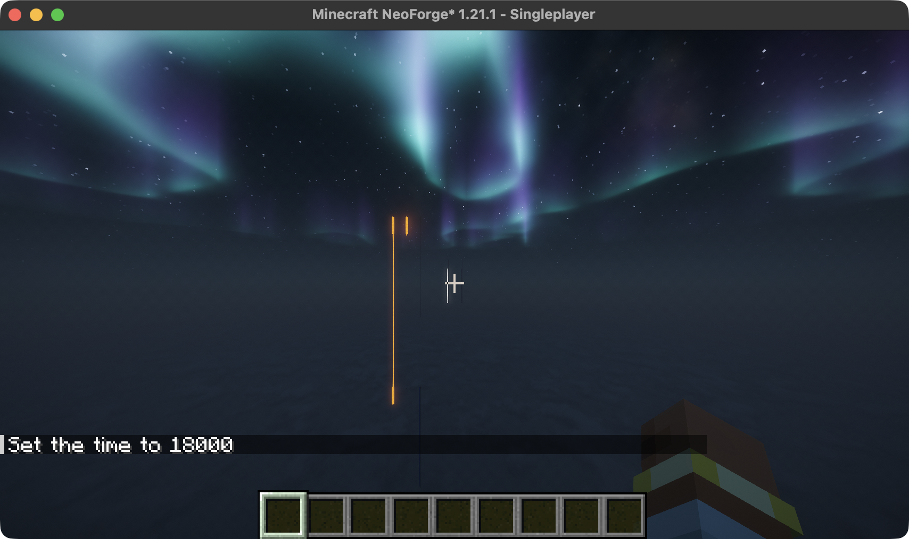
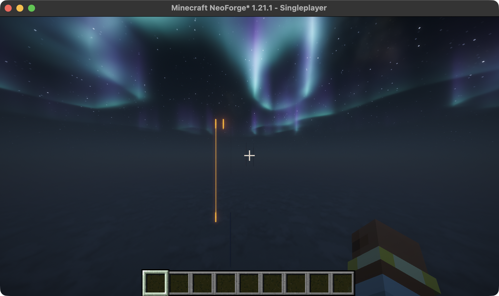

# Distant Horizons integration

Compat uses DH's ordinary terrain generation, storage and rendering. It does not
provide a separate terrain predictor. Optional hooks target DH 3.3.3 on Minecraft
1.21.1 / NeoForge 21.1.264. The compile-only artifact is pinned by SHA-256 in
`build.gradle`; optional metadata and `OptionalIntegrations` must agree.

## Lifecycle ownership

DH's `ClientLevelWrapper_neoforge.getWrapper` publishes a server-keyed wrapper
after retiring its predecessor. Concurrent readers can claim the same predecessor,
and delayed unconditional removal can erase a replacement. `ClientWrapperHandoffMixin`
publishes the replacement under the cache lock before cleanup. `WrapperCache`
removes entries only while the retiring wrapper owns them. Cleanup runs outside
the cache lock, and delayed upstream publication cannot overwrite a newer owner.
This hook loads only on physical clients.

`ChunkUnloadBudgetMixin` limits each shutdown unload pass to 1,024 queue polls in
Sky Archipelago dimensions when DH is installed. An unfinished generation reference
can requeue an unload callback. Draining indefinitely prevents queued server cleanup
from releasing that reference. Yielding preserves queued work and lets Minecraft
service the executor between passes. Running servers and foreign generators retain
native behavior. Previous integrated-client investigation observed this livelock;
verification of the extracted fix is tracked in [verification](verification.md).

## Cache identity

`WorldIdentity` persists one UUID per saved world. `WorldLevelKeyMixin` uses that UUID
and a hash of the dimension ID in DH's normal server-key handshake. Creation is
opt-in through `savedWorldIdentity`; the default retains upstream keys and caches.
Existing marker files remain authoritative. Server-side database paths do not change.
See [operator configuration](../configuration.md#distant-horizons) before enabling it
on an existing installation.

`LegacyCacheMixin` prevents DH's pre-2.3 dimension-only cache import only for the
complete Compat UUID key format. It leaves the old directory untouched. Ordinary
and merely similar keys retain native migration. This avoids attributing an
unidentified old save to a new UUID cache; it is not a general cache migration tool.

## Luminous columns and fluid colors

DH 3.3.3's `FullDataToRenderDataTransformer.setRenderColumnView` transfers an
ignored noncolliding block's color and material to the segment below when
`tintWithAvoidedBlocks=true`. With glow lichen, one thin surface block can therefore
make a tall stone segment emissive. The same path can replace lava's or water's
color and material. Complementary/Euphoria's `DH_BLOCK_ILLUMINATED` branch makes
the resulting gray-green segment particularly bright.

The physical-client probe reproduced this through DH's actual conversion code:
lichen above a 40-block segment changed stone, lava and water to material 15
and color `ff72847a`. Without lichen, lava was material 6 / `ffd96f21` and water
material 12 / `bf2b529f`. A rendered stone/lichen fixture produced a white stripe
at night. Native source and flowing lava states retained the correct orange
particle color; this was not a general failure to recognize flowing lava.

The smallest verified remedy is to append `minecraft:glow_lichen` to
`client.advanced.graphics.culling.ignoredRenderBlockCsv` in DH's configuration.
Preserve the other entries. This excludes lichen from distant representations;
native lichen, fluid rendering and ordinary foliage tinting remain unchanged.
Reopening the same fixture and LOD database removed the stripe and preserved
all three substrates' original materials and colors. No cache deletion or new
fluid Mixin is needed. Compat does not rewrite an operator's DH configuration;
the modpack owns its chosen default.

| Lichen included in LOD tinting | Lichen excluded; same saved fixture |
| --- | --- |
|  |  |

The left stone column has one side-supported lichen block above it; the right
column is the bare control. Lava and water columns remain in the same scene.

Live inspection also identified native glow lichen at the reported island, but
did not prove that every historical pale-fluid observation has this cause.
Modded fluids and other shaders remain untested. If the symptom persists with
this exclusion, capture the exact affected column before approaching it: normal
fluid ticks and newly captured chunks can change the evidence.

### Upstream report candidate

Report the tint/material transfer to DH, with 3.3.3, Minecraft 1.21.1 and NeoForge
21.1.264 as the tested versions. Use a side-supported glow-lichen block directly
above a tall stone segment and a matching bare control; inspect it beyond native
render distance with `NON_COLLIDING` and `tintWithAvoidedBlocks=true`. The same
conversion input over lava/water demonstrates incorrect fluid material assignment.
The report should distinguish intended foliage tint approximation from carrying
an emissive material through an entire segment or replacing a liquid material.
The per-block exclusion is a workaround, not an upstream algorithm correction.
No report has been submitted.

## Dependency updates

| Boundary | Recheck when updating | Required evidence |
| --- | --- | --- |
| Client wrapper ownership | DH `getWrapper`, `onUnload`, keyed branch and weak-reference map | Concurrent ownership tests, actual connection/reconnect and shutdown |
| Shutdown unloading | Minecraft `ChunkMap.processUnloads`/`scheduleUnload`; DH generation cleanup | Isolated shutdown with generation active, retained queued work |
| Cache identity | DH server wrapper key creation and level-key handshake | Default-key preservation, opt-in identity across reopen and dimensions |
| Legacy import | DH `DhClientLevel` constructor's legacy-folder check | Actual client constructor with ordinary and Compat keys; no user cache edits |
| Fluid colors | DH block/material wrappers, client color cache and render-data conversion; installed shaders | Known source/flow states, native/LOD views and shader controls |

Keep optional adapters selected through loader metadata before resolving DH
classes. Do not load client hooks on a dedicated server. Preserve independent
terrain, BlueMap and physics behavior when changing this integration. The separate
Veil Iris Fix and resource patches retain their own ownership; do not duplicate
those fixes here.
