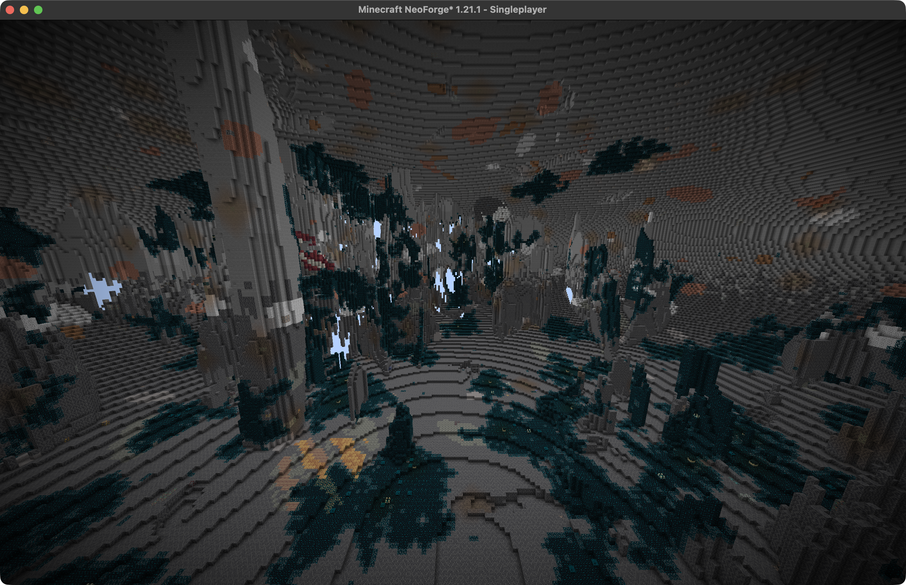
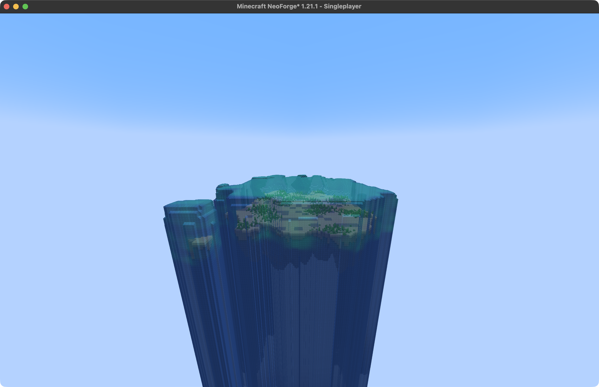
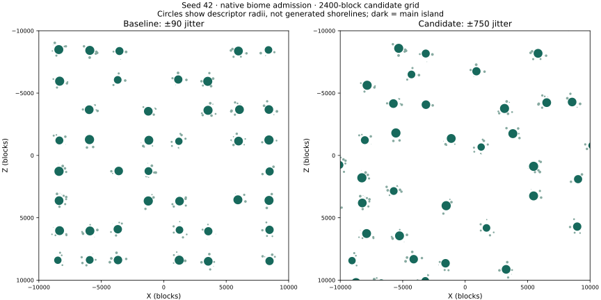
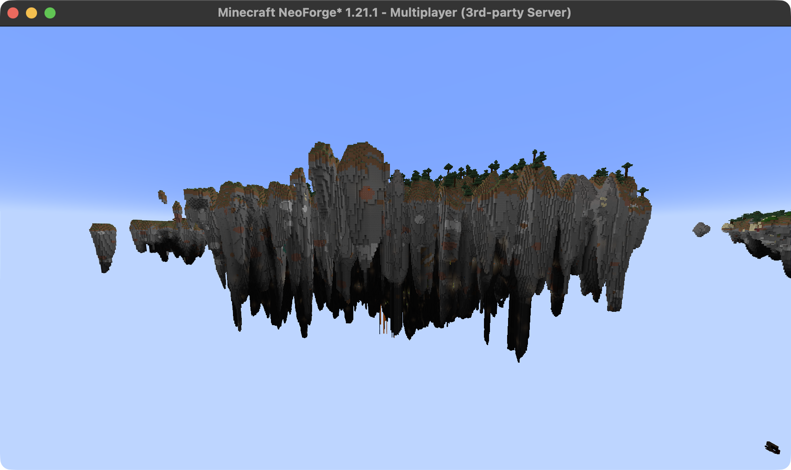
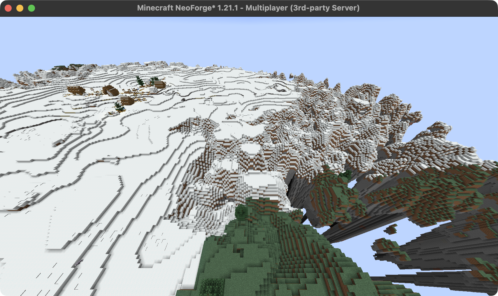

# Verification

## Release 0.6.0

2026-10-29, macOS arm64 / Temurin Java 21. Background checks only, as requested.
The tested binary SHA-256 is
`f0e9f715ee9b4e0991d7e3d885dce01c985655fbb9511eff743826dae31708ce`.
This is the 0.6.0 implementation before a metadata-only trailing-newline cleanup;
final binary SHA-256 is `6b6b5abc76d13fb9f65aa3945b2e110b2b9ad49db9f51d4582368670ad86a836`. ZIP comparison found only
that TOML whitespace difference, with identical parsed metadata and identical
classes/resources. The background evidence therefore applies to its implementation.

`JAVA_HOME=/Library/Java/JavaVirtualMachines/temurin-21.jdk/Contents/Home ./gradlew check build probeJar`
passed: 63 JUnit cases, five release-tool cases, exact upstream hashes, packaging,
and the framebuffer server-side exclusion probe. Released-target transformations
cover the original Veil Iris injection plus the framebuffer wrapper, Aeronautics
balloon callback, both NeoForge tessellation overloads, and Sable model-data query.
Controlled framebuffer execution checks GUI/world/shadow behavior and exceptional
restoration. Balloon execution preserves the callback outside a shadow pass and
cancels it inside one. Material-scope checks cover recursion and exceptions.
These checks do not use native GL or establish visible shader results.

`python3 tools/startup_probe.py --server <installed-server>/game --java <java21> --scenario <case>`
passed all seven cases: `standalone`, `terrain-disabled`, `terrain`, `all-disabled`,
`unsupported-disabled`, `unsupported-enabled`, and `full`. Each uses a disposable
loopback dedicated server and removes its save afterward. Standalone and disabled
cases reached Done with no active adaptations and no exported transformed target
referencing Compat. Unsupported-target fixtures advertise version 999.0.0 without
target classes; disabled passes, while enabled rejects the exact terrain pin with
a feature-file remedy. The full installed server selection reached Done and exited
normally with 18 common/server adaptations. These fixtures do not exercise a
physical client or every possible feature combination. The full fixture still
logs upstream Struts/C2ME client-target warnings, Power Grid’s native-backend
fallback, resource warnings, and two nonfatal IslandField Mixin analyzer errors.
A matching installed-0.5.2 control also reached Done and produced both analyzer
errors; they are not introduced by this release. Successful startup is not a
claim of an error-free upstream log.

`python3 tools/probe.py --generation adapted --minimal --seed 42 --reopen --heap 6G --server <installed-server>/game --java <java21>`
passed native generation and reopen with matching ore counts. It uses only Compat,
Sky Archipelago, and the separate probe; no play save is opened. The scan took
30.17 seconds including startup/reopen. This supports preset resources and default
generation continuity, not a new multi-seed qualification of terrain algorithms.

Interactive client startup, shader-on/off Ponder controls, balloon visuals,
construct materials, shader/resource reload, and flickering-shadow comparisons
remain pending. No desktop focus was taken. The gapped/flickering cast-shadow
symptom remains unresolved; see [rendering scope](rendering.md). Historical native
checks below belong to their recorded versions and do not verify this release's
combined client rendering.

Checks use Java 21, Minecraft 1.21.1 and NeoForge 21.1.264 with the exact upstream
pins in `build.gradle`. Results below distinguish integration checks from historical
terrain checks; a source inspection does not establish runtime behavior.

## Release 0.5.2

On 2026-10-29, `./gradlew --offline --no-daemon check build probeJar` passed
47 Java tests, five release-tool checks, pinned dependencies and package checks.
The release binary has SHA-256
`0228b2cd34f402114ba6bf57a02e29b6d03c2b294dd8f970b37bd523a828320e`.
Compared with 0.5.1, only optional integration selection and version metadata
changed among existing entries; `AnalogAudioCreateMixin` is the only added entry.
Terrain, physics, resources and other integration classes remain byte-identical.

The maintained `tools/probe.py --audio SELECTION` runner used the Create Sky
0.1.18 installed server as a read-only dependency source, Java 21 and Apple silicon
macOS. All five selections passed: `minimal`, `create`, `analog`, `pair`, `full`.
The first three left the adapter disabled. The pair and full pack registered
upstream `RadioMovementBehaviour`; a control drill handler remained present.
Radio `tick` and `stopMoving` completed on the dedicated server without client
class loading. Full startup no longer logged the movement-registration exception.

The same pair probe with `--mod` pointing to published 0.5.1 reproduced the
`NoSuchMethodException` and failed because the radio handler was missing. The matrix reports retain exact loaded JAR hashes; disposable worlds and raw
logs were removed after review. No live instance was modified.

This checks the applied common-setup Mixin and dedicated-server callbacks. It
does not establish audible playback, client GUIs, moving audio positions or all
contraption lifecycle cases. Those remain interactive checks of the upstream
handler; the adapter does not rewrite it. See [maintenance](README.md#analog-audio).

## Release 0.5.1

The 2026-10-28 release candidate has SHA-256
`1a340ef70560c78edb2e6d3416769fa068a784db54818418a9783a1381a91a9d`.
`./gradlew check build probeJar clientProbeJar` passed: 47 Java tests, five Python
release-tool checks, upstream pins and package boundaries. Compared with the
installed 0.5.0 JAR, existing terrain/adaptation entries are byte-identical; only
the entrypoint, optional integration selection and metadata differ, with new DH
classes added.

A fresh minimum-install `--generation adapted --minimal --seed 42 --samples 1`
completed its native block survey. The full-pack `--dh-pregen --dh-stop-after 2`
fixture reported generation active at stop, preserved the ordinary DH key without
creating a saved identity, and exited normally. It used C2ME 0.4.0-alpha.0.124,
Ponder 1.0.87, Radars 5.0.2, Fzzy Config 0.7.7+fix1, JEI 19.70.0.464 and
Core Library 1.1.26 alongside the pinned integration versions. The same full set
passed `--chunk-futures --seed 42`, including retained-ticket completion and ADQ
rejection cleanup.

The isolated physical-client material check converted ten sampled modded
terrain types plus stone, deepslate and grass through DH's real transformer.
All retained their 32-block column and opaque, texture-derived color; none used
the missing-texture sprite. This checks conversion, not every distance/shader
combination. The expanded preset and unrelated worldgen were not modified.

## DH integration

On 2026-10-28, `./gradlew check build probeJar clientProbeJar` passed, including
47 Java tests, five Python release-tool checks, exact dependency pins and
package-boundary checks. The tested artifact has SHA-256
`7d6f5fa4da9f159761f7e00d44e7f89c2b3caeb1cb58ac17014e694fcae0055b`.
Its existing terrain classes, adapters and resources are byte-identical to the
installed 0.5.0 release. Only the entrypoint, optional integration selection and
metadata changed among existing JAR entries; the DH classes are additional.
The unchanged version label does not identify this unreleased build's content.

| Check | Observed result | Artifact SHA-256 prefix |
| --- | --- | --- |
| Minimal `--generation adapted --minimal --seed 42 --samples 1` | Native block survey completed; optional DH and other integrations absent | `7d6f5fa4da9f` |
| Full-pack `--chunk-futures --seed 42` | ADQ retained chunk loading and rejection cleanup passed; process exited normally | `a234216e2436` |
| Full-pack `--dh-pregen --dh-stop-after 2 --seed 42` | Generation active at shutdown request; normal exit; default DH key retained without creating a UUID marker | `5cc05d968779` |
| Full-pack shutdown with `--dh-world-key` | Generation active at stop; normal exit; explicit UUID key observed in actual server wrapper | `7d6f5fa4da9f` |
| Default/opt-in cache key unit checks | Default leaves no marker; opt-in persists across reopen and config reset; malformed markers fail | `7d6f5fa4da9f` |
| Physical client constructor | Compat UUID keys preserved legacy folders; ordinary and similar-looking keys retained DH's native migration | `7d6f5fa4da9f` |
| Client/server lifecycle | Connected, changed Overworld → Nether → Overworld, disconnected and reconnected; normal shutdown | `7d6f5fa4da9f` |

A control using the installed pre-cleanup Compat artifact (`8fb487b85333`) also
exited normally in the dedicated-server shutdown fixture. This fixture verifies
normal shutdown and key preservation; it does not reproduce the earlier
integrated-client unload livelock or establish a timing improvement. The client
checks verify real hook application and ordinary lifecycle behavior; they do not
deterministically reproduce the concurrent race. Ownership interleavings are
covered separately by the concurrent tests.

Automated fixtures used disposable directories, copied configurations and loopback
ports. The network fixture enabled saved-world identity: the island Overworld used
its UUID key across reconnect; the foreign Nether kept DH's ordinary key. No
prediction provider or SeedGen was installed. The renderer client excluded
Connector, Surveyor and Hoofprint because Connector cannot launch in the tested
ModDev environment. owo-lib's development handshake mode was matched explicitly
on the isolated server. These are harness constraints, not production pack changes.

`ClientDhFluidProbe` measured lava/water states 0, 1, 7, 8 and 15 on a physical
client. Known columns were viewed natively and as LODs with shaders off/on, then
saved and reopened without clearing the DH database. A side-supported lichen
fixture reproduced the luminous column. Actual DH conversion changed stone, lava
and water to lichen's material/color; excluding lichen preserved each substrate.
The bare control and native lichen remained unchanged. The shader was Complementary
Unbound r5.9.3 + Euphoria 1.10.5, through Iris 1.8.14-beta.1 with DH 3.3.3.
See [evidence and workaround](lod.md#luminous-columns-and-fluid-colors).

An authorized live-client observation confirmed pale distant cliff patches and
native glow lichen, with orange native lava nearby. This does not establish that
all reported historical flowing-liquid anomalies share the same cause. Modded
fluids, other shader packs and the complete Connector client stack were not covered
by the isolated rendering check. No personal installation received the candidate.

## Release 0.5.0

The versioned release candidate passes `./gradlew check build` on Java 21.
All 40 JUnit results remain valid for unchanged classes; the five release-tool
checks, package boundaries and exact upstream artifact checks pass. Comparing
its production JAR with the qualified `2fdc7f4f…` artifact changes only
`META-INF/neoforge.mods.toml` (the mod version). Terrain, saved generation identity,
adapters and resources remain byte-identical. Native evidence below therefore
applies to the release code; this comparison does not replace release CI or the
post-publication server reopen check.

The published 0.5.0 JAR passed the Linux/Windows/macOS CI comparison and matched
local SHA-256 `8fb487b8533389f224d7133312e854f308a44c6c69ca5af8dc0d3a80f09405f0`.
Create Sky 0.1.16 installed that artifact on both local sides. The dedicated
server reached Done with its previous generation marker, server properties and
DH settings preserved. Startup error-message comparison found no new messages
relative to its preceding launch. BlueMap served its active schema-2 adapter;
the same DH pregen command was accepted once without completion polling. The
client's native empack prepare check passed without file changes; Minecraft was
not relaunched for a fresh visual check.

## BlueMap adapter

The restored adapter artifact is
`2fdc7f4fff387c42330a2f2e7e8cb6c75f409e2334ceea68448268e37b3cd3e3`.
`./gradlew check build` passed 40 JUnit and five release-tool tests. Byte comparison
against the preceding terrain candidate `58377f…` found changes only in the
entrypoint, optional integration predicate and BlueMap Java/browser implementation;
terrain classes and resources are identical.

The seed-42 minimal native generation/reopen check passed without BlueMap.
`tools/bluemap_probe.py` passed dedicated-server startup, selection, bounds,
reload and shutdown with only Sky Archipelago, Compat and BlueMap. Expanded bounds
were −128..768 exclusive; ordinary bounds were −64..320. A flat foreign world
was excluded and shutdown cleared the manifest in all three cases.

Headless Chrome inspected existing saved map tiles through the read-only preview.
At camera distance 1600, enabling the adapter reduced stretched empty-edge
triangles compared with stock; disabling and re-enabling restored the expected
renderer without page errors. The inspected dense island reached the 256 MiB
retained-geometry budget and reduced its detailed radius to 128 blocks. A view
from Y≈9 showed detailed underside geometry but also unresolved coarse sheets.
A 20,000-block pan and return exercised the floating-origin transition without
page errors. These checks do not establish complete stacked-terrain rendering,
whole-world visual correctness or compatibility with other BlueMap versions.

The full local server then reopened the existing marked world without changing
its generation identity. Its live webapp served schema 2 for `world` and headless
Chrome confirmed the adapter active. The same DH pregen command was accepted once;
no completion poll followed. Both stopped local instances received the artifact,
but no Minecraft client was launched for this pass.

## Ocean prototypes and biome materials

The ocean/material candidate has SHA-256
`58377f93469acc17d5fa4831bdd8ea479fdc7f43d8e3df5550f8dd75f94271ab`.
`./gradlew check build probeJar` passed with 40 JUnit and five release-tool tests.
Ocean variants remain disabled by default. The native fixtures enabled them with
basin/coastal/perimeter selection chances of 0.2 each to find examples efficiently;
those probabilities are not proposed pack defaults.

`tools/probe.py --oceans --ocean-config PATH --fluid-ticks 600 --heap 6G`
passed on minimal seed 42 and full-pack seed 8675309. The full run also supplied
the candidate generation configuration explicitly. Each compared 1,835,008
native fill/query blocks and inspected three distinct water forms after fluid
ticks. The closed and coastal examples had no sampled floor/rim holes or gaps
in planned sources. Perimeter islands deliberately lack a retaining rim; their
unsupported edge columns became falling water, rather than failed containment.

The full run stored cold-ocean, ocean and warm-ocean habitats, with native aquatic
vegetation and applicable aquatic spawn entries. Its coastal sample contained
1,893 beach columns, including 1,806 exposed sand columns. That outlet flowed
onto a nearby ledge; a coastal spill need not immediately become a deep waterfall.
The perimeter sample reached Y=159 after 600 ticks. Vegetation persisted inside
the basins while some edge plants were lost as perimeter water began flowing.
No coral blocks were observed; this does not establish their absence elsewhere
or certify coral acquisition. Natural spawning populations remain unmeasured.

Native work took 61.6 seconds / 3.07 GB peak RSS for the minimal run and
55.4 seconds / 4.40 GB for the full run. These are different generated examples,
with conservatively forced regions, not a comparative performance benchmark.
The full search stopped after finding all three forms; its counts are not an
occurrence survey.

A second minimum-installation seed-42 run used 3,200 fluid ticks on the same
production artifact. Perimeter water reached Y=-128; planned sources remained
intact, and the enclosed/coastal samples retained their floor and rim. Native
work took 201.6 seconds with 3.24 GB peak RSS. This bounded observation does not
establish long-term loaded-world cost or ecological balance.

A full-pack seed-42 material probe on this candidate found 654 mud blocks within
the top three layers of 256 mangrove columns. The earlier minimal check found 655
on `61ddfbc6…`, before the surface-override precedence guard. These establish native
mud placement in both installations, not all override combinations. The adapter
changes actual surface writes because upstream's fixed surface-material enum
cannot retain mud. Reports retain exact hashes and generation settings.

The same artifact completed a full-pack seed-42 native generation/reopen run:
27 chunks, including a cross-cell companion, retained matching generated/query
blocks and reopened ore counts. This used default-off ocean variants and explicit
candidate geometry; it does not certify every optional ocean layout.

The full seed-42 resource survey sampled three anchors with 49 strata each.
It records ore in 16-level reference-depth bands and counts sampled ore adjacent
to air or fluid, excluding chunk-edge columns to avoid neighbor loading. All
three samples contained exposed zinc and iron. Two contained raw copper blocks.
These are witnesses of generated resources, not guaranteed access or per-island
budgets. Native work took 41.9 seconds with 7.42 GB peak RSS under a 6G Java heap;
process RSS includes memory outside that heap. Reports and Atlas retain the counts
and exact probe hash separately from area-weighted estimates.

### Dedicated background generation

`tools/probe.py --dh-pregen --seed 42 --heap 6G` with explicit candidate geometry
completed on the full installation and the same production artifact. DH's native
pregeneration future completed for a 32-chunk-radius job centered at (1282, -673).
Saved region-header entries increased from 133 to 8,122; padding and unfinished
generation stages can contribute to that count. The native job took 37.3 seconds
(60.9 seconds including startup), with 3.77 GB peak RSS. This disposable test
exercises the dedicated DH path; it does not predict 1024-radius completion time.

### Client review

An independently installed empack reference snapshot loaded the full client set
and created seed 8675309 with the recorded OVERLAP policy and boosted ocean fixture
settings. Shader-off spectator review used night vision for interior inspection;
it does not represent ordinary cave lighting or a survival traversal test.

The hollow at (-725, 262, 933) contains a substantial chamber with rock pillars,
exposed ores and native sculk. Its surrounding terrain has openings and narrow
outer branches. The noise-cave sample at (-997, 139, -1632) contains native lush
decoration and exposed deepslate. Classic carvers remained enabled in both.
These views support retaining the current composition for playtesting; they do
not prove every chamber has a safe or connected entrance.
The client save reopened successfully with its recorded generation identity.

The coastal example near (-22443, 453, 792) has a sand shore and aquatic plants.
The perimeter example near (-20214, 294, 4050) retains a submerged rock body and
develops a broad falling-water curtain. Its visual footprint is substantial;
keep this experimental variant disabled by default rather than treating it as
an inexpensive substitute for an ordinary companion island.

## Local water

The source-water/lining candidate has SHA-256
`fe7912fb9b656c34e20e21fd9c53475499732cfceb57b9c88ad4d0413bfd7e21`.
`./gradlew check build probeJar` passed with 38 JUnit and five release-tool tests.
The boundary tests include deep, narrow bowls whose stepped floors need vertical
lining as well as a horizontal bed. Native water probes use the installed server
as read-only input and delete their isolated worlds afterward.

| Check | Observed scope |
| --- | --- |
| `--water --seed 42 --fluid-ticks 600 --heap 6G` with explicit candidate geometry | Full mod set: 1,835,008 fill/base-column block comparisons, water-surface/solid-floor height agreement, no sampled floor/rim holes or air gaps inside planned basin sources, flowing overflow and underside outlets |
| `--water --minimal --seed 8675309 --fluid-ticks 3200 --heap 6G` | Same checks over a second seed; underside water reached Y=-128 while its basin remained intact; cold surface ice persisted |
| Native carvers disabled, full seed 42 | Control removed the unexpected air beneath basin sources, identifying classic carving as the cause; source-water protection fixed it with carving enabled |

The full 600-tick run used `6f55d160…`. The candidate above adds the saved
`waterPolicy` identity field without changing terrain composition and was used
for the 3,200-tick run. Reports retain complete production/probe hashes and installed
mod lists. The full run took 47.2 seconds for admission, generation and 600 ticks,
with 3.57 GB peak RSS. The longer minimum-installation run took 178.6 seconds with
2.38 GB peak RSS. These bounded observations are not a throughput benchmark.

The 21-by-21-cell admission surveys found 16 basins among 232 anchors in seed 42
and nine among 207 in seed 8675309. Terrain support rejects some candidates after
the configured probability draw. Three selected regions per seed provide the
material/fluid witnesses; this does not establish global occurrence rates.

The water-animal height predicate passed at positions with real water clearance;
out-of-region and foreign-generator controls retained their original sea level.
This verifies height eligibility, not natural spawn populations, ocean vegetation
or complete habitat. Native springs can flow below a sealed basin independently;
low water blocks alone are not a containment test. Visual appearance, long-term
ecology and optional ocean variants remain separate checks.

## Interiors and large veins

The `islands_v1-prototype-10` material/interior candidate has SHA-256
`948586b2a28f9030d959fe022b81dd24cf0f3cf5ea7cb0da59e22e8a54b8dee9`.
`./gradlew check build probeJar` passed, including 36 JUnit and five release-tool
tests. Native commands below used `tools/probe.py`, an installed server as read-only
input, Java 21 and `--heap 6G`. Full-pack runs used the explicit candidate geometry
JSON rather than inheriting the installed server's older tuning.

| Native check | Observed scope |
| --- | --- |
| `--overlap --minimal` | Six clusters across seeds 1, 42 and 8675309; upper exterior intervals unchanged, sampled retained rock increased 0.6–1.2% |
| `--interiors --minimal --seed 42` | Baseline/noise/hollow sections; 86 independent direct/snapshot comparisons |
| `--interiors --minimal --seed 8675309` | 108 independent comparisons, including uncached exterior/interior planning stages |
| `--veins --minimal --seed 42` | Raw copper and iron agree between native noise fill and base-column queries; both survive in completed chunks |
| `--coverage --minimal --seed 42` | City eligibility, query-scope restoration, ordinary-generator and locate-preview controls pass with interiors enabled |
| `--generation adapted --seed 1 --reopen` | Full mod set including C2ME; 6,193,152 fill/query block comparisons and unchanged reopened ore counts |
| `--islands --seed 1` | Full-set generated samples across three anchors; supported spawn and spatial resource samples |

The overlap comparison used the pre-interior exterior baseline. The seed-42
interior sections precede the planning-stage additions. Full-pack generation and
the island survey used material/interior artifact `d556837e…`; the later candidate
adds scoped planning queries without changing complete terrain composition. Reports
retain exact hashes; these checks do not certify later untested changes.

The two noise-interior examples removed 6.5% and 7.3% of sampled exterior rock.
Hollow examples removed 21.5% and 23.1%, with largest sampled vertical gaps of
127 and 125 blocks. These are selected sections before native classic carving,
decoration or fluid updates, not global frequency estimates or proof of connected,
walkable caves. A baseline anchor can overlap a differently selected companion;
its footprint is not an assertion that every contributor has baseline interiors.

Raw copper was observed at (−959,292,−1237), reference Y=34; raw iron at
(3682,182,−1788), reference Y=−32, in seed 42. The sparse witness search missed
raw iron, despite finding iron ore and tuff. Inspecting one complete noise-filled
chunk around a witnessed iron vein found it. This targeted search establishes
material generation, not scarcity or mining accessibility. The broader island
survey also remains a sample, not a complete ore inventory.

The full generation/reopen run took 43.6 seconds including startup and shutdown,
with 3.20 GB peak process RSS. The three-island resource survey took 64.9 seconds
with 7.10 GB peak RSS at a 6 GB maximum Java heap; RSS includes native allocations.
These single observations are not a throughput benchmark. Cavern appearance,
entrance usability, support after native carving, and fluid behavior require
separate visual and runtime checks.

## Generation coverage

The coverage candidate has SHA-256
`d0416871fbb09c9d8d04d8efe6c2d1028bb78aeac559efc2d81b4fb670015977`.
It adds ancient-city eligibility and locate-preview corrections, plus a saved
structure-policy identity field. Existing terrain classes/resources are unchanged
from the terrain baseline except that guard and the new registered hooks.

`./gradlew check build probeJar` passed. Native commands used Java 21, `--heap 6G`
and the installed server directory as read-only dependency input:

| Command arguments to `tools/probe.py` | Evidence |
| --- | --- |
| `--coverage --minimal --seed 42` | 19 biome controls, ordinary-preset exclusion and locate-preview controls |
| `--coverage --seed 1` | Full mod set; 16 biome controls and the same exclusions |
| `--structures --seed 42` | Full mod set; realized underground layouts, locate and Lootr conversion |
| `--surface-structures --seed 42` | Full mod set; surface/water-family survey and Lootr conversion |
| `--surface-structures --minimal --seed 1` | Second seed and minimum-install surface/water survey |
| `--generation adapted --minimal --seed 42 --reopen` | Saved-world identity, terrain/query agreement and reopened ore counts |

Reports under ignored `build/verification` identify production/probe hashes,
installed JAR names and runtime selection. The archive inventory additionally
hashed 389 archives including nested JARs; its definition filter did not include
every tag, preset or noise-settings resource. Runtime resolution, not filenames,
established 53 possible Overworld biomes, 157 top-level features, 240 registered
placed features, 203 configured features, 35 structures and 21 structure sets.
The latter registries include other dimensions. Resource stacks captured 1,118
worldgen, biome-modifier and worldgen-tag paths with pack priority.

Typed traversal from Overworld biome features reached 182 registered placed and
149 configured features. There were 61 height-range paths and no nested
height-range path; blue ice was the only untagged root using one. Six modded roots
were Create zinc/striated Overworld and four Propulsion platinum entries. The only
non-vanilla registered structure was `skyvillages:skyvillage`. Effective resources
confirmed that the pack's Sky Villages processors/pools override their upstream
counterparts. This excludes neither arbitrary runtime callbacks nor future mods;
rerun the inventory after dependency/config updates.

### Corrected eligibility and lookup

Eight sampled Deep Dark footprints failed the baseline city midpoint precheck.
The correction made all eight eligible; the 19 seed-42 controls included 14
non-Deep-Dark columns. All 16 seed-1 controls also matched the expected projected
biome. Trial-chamber queries and ordinary Sky Archipelago eligibility were unchanged;
query scopes were restored. Native support checks still rejected some layouts.
Ancient cities were not universally absent before this correction.

A matched seed-42 control JAR omitted only `StructureLocateCheckMixin`. The city
and mineshaft had valid starts and realized blocks, but locate reported absence
even after their source chunks reached FULL. With the hook, both resolved; the
stronghold and trial chamber remained discoverable. Separate controls retained
known-empty chunks, rejected ocean-disabled WATER structures, and compared five
ordinary-preset preview results with direct native calls.

| Structure | Accepted / queried, seed 42 | First realized layout |
| --- | ---: | --- |
| Stronghold | 2 / 8 | Eight pieces, 12 portal frames, one spawner, one chest |
| Trial chambers | 2 / 4 | 254 pieces, 13 trial spawners, 13 vaults, 18 chests |
| Ancient city | 1 / 16 | 56 reinforced deepslate, 20 chests and sculk/shriekers |
| Mineshaft | 2 / 4 | 174 rails, three spawners, one chest minecart |
| Badlands mineshaft | 0 / 16 | No accepted candidate; realization unverified |

All four realized types were locatable in the full set. The matched minimal
control/correction runs took about 46 seconds including startup, generation and
shutdown; they do not isolate lookup overhead. In the final full run, the first
stronghold lookup took 2.33 seconds; the other three were below one millisecond
with candidates already generated. This is not a bound on a cold, wide-radius
search. Upstream locator Y=0 is not a safe landing position.

### Surface structures and containers

Seed 42's full-set survey realized plains, desert, savanna and snowy villages,
an outpost, both temples, a witch hut, trail ruins, ordinary/mountain ruined
portals and both shipwreck variants. Seed 1's minimum run also realized plains
villages, an outpost, jungle temples, trail ruins, portals and both wreck variants.
Every realized sample's locate check succeeded. Counts are from at most 16 selected
candidates per type, stopping after two acceptances; these are not occurrence rates.

Neither survey accepted a taiga village, mansion, igloo or buried treasure in its
selected candidates. Their upstream routes exist, but usable realization remains
unverified here. Ocean monuments and both ocean-ruin families had zero starts,
consistent with the explicit ocean-disabled WATER policy. These failures should
not all be described as missing generation.

Full-set runs loaded a 5×5 neighborhood around one generated chest, then allowed
100 server ticks. Both the stronghold and plains-village samples converted to
`lootr:lootr_chest` with their original loot-table IDs preserved. Earlier immediate
captures showing `minecraft:chest` were before this lifecycle. Native table rolls
also contained Camping's injected enderbag. Per-player Lootr entitlements, all
container types and completed survival encounters were not exercised.

### Remaining limits

The [terrain document](terrain.md) owns the source-backed differences: custom
surface palettes, separately composed interiors and vein materials, ocean-dependent
acquisition, native carver aquifer coordinates and column-overlap handling.
These require separate design or focused realization checks, not blanket parity
patches. No additional installed ore/structure registration was missed by the
resolved inventory. That conclusion does not cover every arbitrary code callback.

Surface access to caves, rare-biome structures, natural fluid behavior and
long-distance progression remain playtest concerns. No new visual
flight or survival session was performed for these two structure fixes; native
block/loot/query checks are the evidence above. Prior silhouette, weather and
terrain surveys below remain attributable to their original artifact.

The first full coverage capture encountered a DH shutdown exception and was not
counted as passing. Later captures allow settling ticks and exited cleanly; this
is harness lifecycle evidence, not a DH production fix. Disposable worlds were
removed. The playing server, world and DH task were not changed or polled.

## Horizontal arrangement

Compare the original 90-block jitter with the 750-block candidate at the same
2400-block indexing grid. Both reports contain five seeds, native biome admission
and descriptor previews to 16,000 blocks. For anchors within 10,000 blocks, find
the nearest captured anchor and fold its direction modulo 90 degrees. Directions
within 10 degrees of a cardinal axis fell from **149/155 (96.1%) to 52/136 (38.2%)**.
The accepted anchor count fell by 12.3%. Changes include clearance and displaced
biome admission as well as jitter; this is not an isolated jitter benchmark.

| Seed | Anchors | Mean / largest nearest-center distance | Minimum support gap | Sampled shore gaps |
| --- | ---: | --- | ---: | --- |
| 1 | 30 | 2507 / 3490 | 588 | 1058–1405 |
| 42 | 26 | 2497 / 3737 | 461 | 1005–1404 |
| 8675309 | 25 | 2510 / 3103 | 421 | 1378–2015 |
| 424242 | 25 | 2348 / 3366 | 425 | 873–1268 |
| -3095298318114116683 | 30 | 2395 / 3427 | 385 | 1027–2637 |

Distances are blocks, rounded. The lowest sampled support gap remains above the
350-block policy. Three nearest-center pairs per seed supply the shore estimates;
these are not global nearest-shore proofs or navigated journeys. The retained
2400 grid indexes candidates, not equally spaced accepted clusters.

The plot shows descriptor radii, not actual coastlines. Seed 42's bounded query
check exercised 225 cells: 137 eligible candidates, 114 accepted and 23 rejected
by clearance. Reverse and parallel query order matched. All 29 companions crossing
cell boundaries retained the correct geological owner. Unit tests additionally
exercise exact clearance boundaries, priority ties, negative coordinates and the
derived neighbor search against exhaustive candidates.

## Terrain and resources

Full and minimum seed-42 runs each compared **6,193,152 generated/base-column
blocks** across 27 chunks, including a companion across a cell boundary. Both
reopened with matching ore counts. The minimum installation contains only Sky
Archipelago, Compat and the disposable probe alongside Minecraft/NeoForge.
An isolated physical client also reached the title screen with Sky Archipelago
and Compat and no BlueMap; that check establishes loading, not survival gameplay.

Six anchor surveys used 49 spatial strata each. Counts combine ordinary and
deepslate ores in sampled anchor-owned columns, not complete island inventories.

| Seed / center Y | Observed block Y | Headroom | Zinc | Diamond |
| --- | --- | ---: | ---: | ---: |
| 42 / 269 | 63–315 | 452 | 368 | 54 |
| 42 / 337 | 51–399 | 368 | 415 | 79 |
| 42 / 321 | 118–370 | 397 | 515 | 137 |
| 8675309 / 354 | 105–405 | 362 | 372 | 65 |
| 8675309 / 281 | −32–343 | 424 | 295 | 33 |
| 8675309 / 292 | 85–331 | 436 | 199 | 30 |

All six contained zinc and diamonds. This does not guarantee mining access,
quantities per trip or scarcity for every spawn. No sampled column had the
probe's eight-block-deep surface opening; absence in these strata does not prove
there are no cave entrances. Surface access remains a playtest concern.
Sampled straight center lines had longest void intervals of 1494–2300 blocks.
They are neither altitude-safe flight routes nor movement-time measurements.

Shader-off client review inspected the current seed-42 body and underside,
plus a contiguous cold/temperate boundary. Initially incomplete distant terrain
was excluded from the visual evidence. The retained body view shows continuous
taper rather than a broad bottom slice; it is not a proof for every archetype.

## Snow, biomes and integrations

Contiguous 48×48 areas on seeds 1 and 42 covered temperate, cold and transition
regions. The probe compared stored quart biomes, smoothed/player-facing queries,
reference-height temperatures, tags, surface materials and exposed snow. It then
removed snow layers and applied an explicit native precipitation sweep. No warm
stored-biome snow blocks or warm-weather snow columns were found. This is a
controlled weather invocation, not hours of observed natural weather.

Boundary disagreement between stored and smoothed biomes was observed: 83 of
2301 sampled columns in seed 42's transition area. Cold-biome surface rules can
select snow independently of altitude cooling. These are plausible explanations
for a grainy edge, not a reproduction of the friend's unidentified location.
The cause of that particular observation remains unresolved. No global biome
smoothing or additional temperature fix was justified.

Seed 42's cave/feature check found lush caves, dripstone caves and deep dark with
matching stored biomes and unchanged surface projections. Deep dark retains
upstream's fixed −48 proxy and lower-column restriction; it does not use exactly
the same frame as the other two targets. A direct geode placement and warm/cold
portal material fixtures passed. A seed-1 high-portal search found no suitable
fixture; that run does not establish a production defect.

Seed 42's village plan retained the zero-to-three allowance, with target counts
`[26,7,3,1]`. Eleven starts were accepted and two fully generated; reopening and
order checks matched. Native delivery endpoint checks passed. These establish
placement and endpoint handling, not completed deliveries or route budgets.
Pressure, client climate scope, classic carvers and geological feature mappings
remain in their owning terrain adapters. No new noise caves or aquifers were added.

## Cost and limits

A shared benchmark queried 122,412 columns and requested 18 chunks against the
original installed 0.4.0 and the candidate. Column time was 2.97 → 2.82 seconds;
chunk time was 1.42 → 2.28 seconds; peak process RSS was 3.03 → 3.11 GiB. The
terrain differs and this is one workload, so the chunk difference is not a causal
estimate of clearance overhead. The larger island surveys peaked near 6.6 GiB RSS
with a 6 GiB Java heap; process RSS includes non-heap allocation.

Local-priority rejection is bounded and order-independent, but not maximal: a
candidate may lose to an eligible neighbor that itself loses elsewhere. The
measured density reduction was accepted without changing island size or weakening
clearance. Longer empty crossings remain possible outside the sampled seeds.

Existing markers reject incompatible generation. Do not delete a marker to adopt
this layout in an old world. Nether/End and ordinary-generator scope were retained;
this pass did not survey every foreign structure, complete cave connectivity or
repeat the earlier release's cargo flight. The previous bounded DH pregen check
is historical evidence, not proof that a new overnight pregen has finished.
