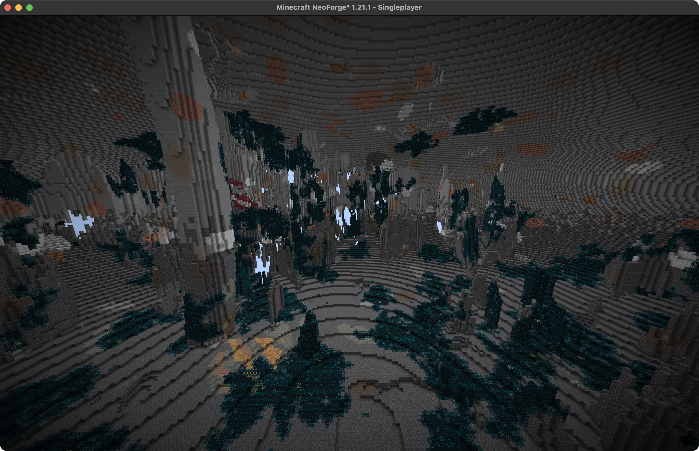
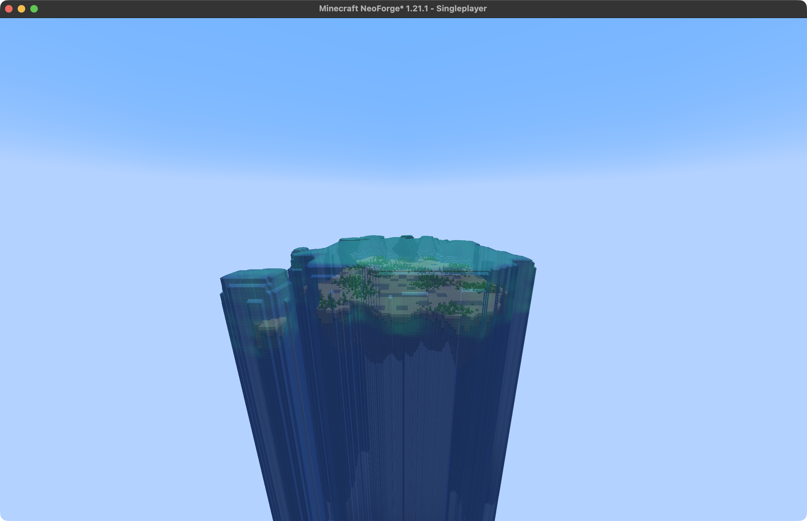
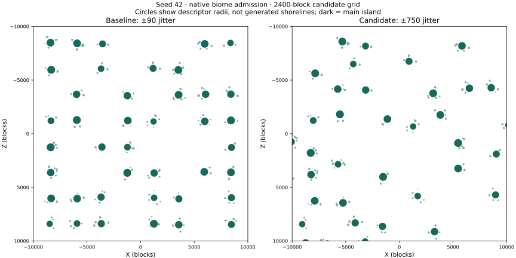
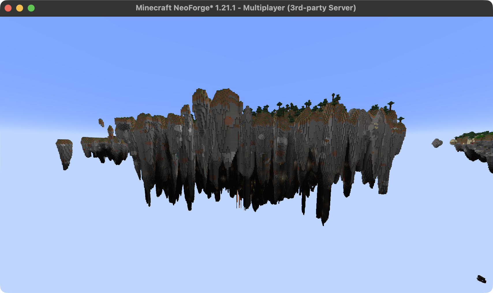
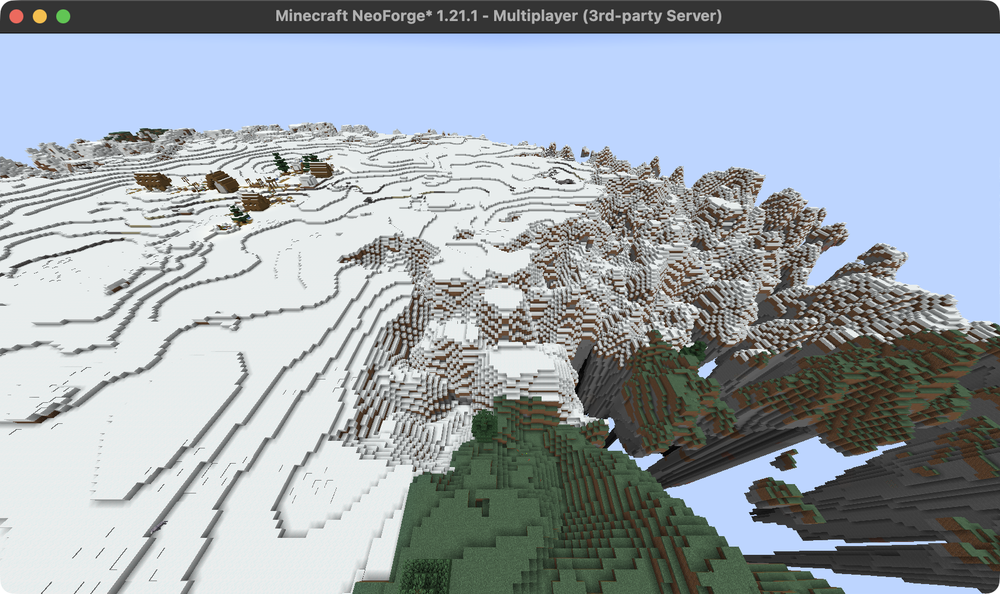

# Verification

## Hanging bridge lanterns, 2026-11-03

The optional Macaw’s Bridges 3.1.2 adaptation preserves empty collision and moves only stair-lantern outlines. A shape-only native control missed a direct outline intersection outside the owning cell. The corrected implementation passes 28 native ray cases across all four facings: outside-cell and ordinary selection, above/below approaches, collision queries, segment endpoints, solid obstruction, nearest lantern and removal. The native bridge remains the nearer obstruction for the low control ray.

Native item placement, breaking and replacement preserve the stair state; resource reload retains selection. The configuration entry renders under Server / shared → Macaw’s Bridges. A cold reopen of the 0.17.0 build retains outside-cell selection. Shader-off captures show the approved upright hanging appearance; flat resource geometry is unchanged. The isolated harness retains the protocol and captures under `images/2026-11-03-macaw-shapes` and `macaw_lantern_review.py`. These checks do not establish arbitrary moving-construct interactions or other Macaw versions.

`./gradlew --no-daemon check build` passes. Dedicated startup passes with no optional mods, Macaw alone enabled/disabled, future targets disabled and the complete pack. The 0.17.0 build's shipping classes match the ray-tested candidate byte for byte. Feature-selection tests cover missing, unsupported and disabled targets on both physical sides. The package check excludes Macaw classes and probes.


## Glass backfaces, 0.16.0

The candidate targets Minecraft 1.21.1 / NeoForge 21.1.264, Create 6.0.10,
Fusion 1.3.16 and Sodium 0.8.13. Native macOS ARM64 checks use Java 21 and the
selected Complementary/Euphoria shader stack, with separate renderer checks
without Sodium or Iris. Shipping SHA-256:
`fc41e9b118521f5ce578740c473312f2f8b229a8fa93ac128ac2928c621da672`.

Inside/outside views cover vanilla glass, light-blue stained glass, Create framed
glass and Rechiseled Create birch connecting glass. In each 3×3 two-layer wall,
all nine reverse surfaces preserve the final outward CT UVs while the opposite
neighbor direction stays hidden. Fusion can emit multiple processed subquads;
comparisons retain every source vertex/UV association rather than assuming one
quad per face. The resource-only prototype failed this same Create case.

Sixteen boundary controls retain native matching/opaque occlusion and covered
CT references, including panes, Create Deco windows and rotated Rechiseled axes.
The registry contains 146 Rechiseled glass pillars; other upstream glass shape
classes are not registered in this pack and are excluded. Create pane geometry
is retained, not replaced by cube geometry. There is no moving-construct, Copycat,
fluid, arbitrary resource-pack or DH backface coverage claim.

The final artifact repeats all four nine-cell thick-wall comparisons and shader
captures. Eight representative models retain identical output after resource reload
and cold reopening. The same artifact with both switches disabled restores all
four isolated one-sided controls. Stills cover selected viewpoints; no exhaustive
camera-motion or shader/flicker matrix is claimed.

Separate Create-only and Fusion-only clients pass the thick-wall CT comparison
without Sodium/Iris or the other CT mod. The minimum integrated client loads with
no optional adapters active. Dedicated standalone, full integration with both
client switches explicitly enabled, and unsupported-but-disabled metadata fixtures
start and exit normally. Neither new client hook is selected on a dedicated server.

The existing native probe bounds model-query repetitions to 2,000. Samples on a
20×20 two-layer Create wall took about 1–6 ms per 2,000 six-direction queries after
warm-up on this host. This measures model queries, not chunk-mesh throughput, GPU
frame time or allocation pressure. Exposed quad counts double; native matching
interfaces remain culled. No cache or performance bypass was introduced.

`./gradlew --no-daemon check build clientProbeJar` passes 114 Java tests, six
Python tooling tests, exact upstream pins and package/resource checks. The new
probe records the registered targets and bounded query timings and acknowledges
old commands on opening; a retained quit command must not close the next run.
Probes and upstream binaries are absent from the shipping JAR.

The Resource Review harness retains captures, native records and executed protocol
under `images/2026-11-03-glass-backface-compat`. Initial captures used a candidate
whose only later resource change was generated English ordering. The final scope
excludes unregistered Rechiseled shape classes; final artifact checks and native
controls are recorded with their own hashes. Renderer hooks and quad reversal
remain the owners described in [rendering](rendering.md#glass-backfaces).

## Glass culling, 0.15.0

Minecraft 1.21.1 / NeoForge 21.1.264; Java 21; Create 6.0.10, Rechiseled 1.2.6,
Rechiseled Create 1.1.1, Fusion 1.3.16 and Create Deco 2.1.3. The isolated native
fixture uses restored upstream window models; the rejected all-face override and
Fusion appended-face prototype are absent from its selected stack.

The final candidate SHA-256 is
`057777a29e61d58a8500c52cf19d29b51e6bbcaa99cc6a753eb50d5deb51107d`.
Both disabled and enabled runs use those same JAR bytes. Native inspection reads
world-aware model data, directional quads/UVs and `Block.shouldRenderFace` rather
than treating raw item-model quads as connected-texture evidence.

| Boundary | Disabled control | Adapted behavior |
| --- | --- | --- |
| Different Create framed/wood/iron windows | Covered face hidden, missing CT context | Visible, CT equals the uncovered reference |
| Same Create window | Internal face hidden | Unchanged |
| Create Deco window against framed glass | Shares Create's affected block implementation | Visible, CT equals the uncovered reference |
| Rechiseled glass, Y against X axis | Face hidden; reverse direction visible | Both directions visible with native Fusion CT |
| Matching Rechiseled axis | Internal face hidden | Unchanged |
| Different Rechiseled materials and cross-mod glass | Visible with native CT | Unchanged |
| Nonconnecting variants, vanilla glass, panes, opaque neighbors | Native behavior | Unchanged |

The first full-pack pass confirmed byte-identical inspected controls across ten
unaffected cases. The final 16-case native pass verifies visibility and compares
visible full-window CT with the same fixture after removing only its cover.
Pane geometry is a separate control, not subjected to a full-cube UV-equivalence
assertion. The Create-only client independently passes without Fusion, Rechiseled,
Iris or optimization mods. Minimum and full dedicated startup checks select no
client glass hooks.

Focused reproduction: build a two-by-two framed-glass wall, then cover half its
front with vertical framed glass. View the wall from inside the covering block.
With `create.window_culling=false`, the covered wall face is missing; enable the
switch and fully restart to compare. For the separate Rechiseled issue, use
`rechiseledcreate:birch_window_panes_connecting[axis=y]` behind the same block
with `axis=x`, then reverse their axes. Native suppression is asymmetric; the
Rechiseled switch corrects that boundary without changing Fusion predicates.
These are upstream-report candidates; no issue was submitted.

`./gradlew --no-daemon check build clientProbeJar` passes 108 Java cases, six
release-tool cases, artifact pin checks and package/resource validation. The final
minimum integrated client has only NeoForge, Compat and the separate probe; its
active adaptation set is empty. The exact final binary also passes minimum and
full dedicated-server startup with no glass target transforms.

The selected Complementary Unbound 5.9.3 / Euphoria 1.10.5 configuration passes
five focused native cases, including both Rechiseled axis directions. Eight
representative cases pass after resource reload and again after a cold fixture
reopen. A moving-view
recording accompanies the saved fixture evidence; no frame-time benchmark or
exhaustive flicker/shader matrix is claimed.

The reusable `glass_culling_review.py` fixture in the Resource Review harness
owns the finite cases, matched cameras and `--verify` native reference checks.
Captures and sidecars remain there. This is not an exhaustive shader, third-party
window, Copycat or moving-construct compatibility claim. No terrain, save identity,
personal instances, worlds or LODs were changed.


## Configuration sidebar, 0.13.0

Verified on 2026-11-01 with Java 21.0.13, NeoForge 21.1.264 and macOS ARM64.
The native client candidate is
`a9d575964ae2eacc695119537aa26410d84632308171681875ea4bb8e100d92e`.
`./gradlew --no-daemon check build clientProbeJar` passed 102 Java tests,
six release-tool tests, exact dependency pins and generated-resource checks.
The shipping JAR contains no client probe or bundled upstream classes.

Separate minimum and full-pack Prism fixtures exercised the real configuration
screen. The minimum client loaded without any optional mods and reported missing
targets without creating their tuning files. Native keyboard checks covered Tab,
up/down navigation and moving into content controls. Separate pane scrolling,
window resizing and GUI scale 3 at a 427×280 logical viewport remained usable.
These checks do not establish every keyboard path or operating-system UI.

Startup checks covered disk save, unchanged running selection, cold restart,
discard/continue dialogs, stale external edits and explicit reload. A read-only
file refused saving without losing the draft or changing bytes. Inverted village
minimum/maximum values refused closing; a corrected range saved. Cancelling a
generation-change confirmation left the file unchanged.

Both journal entrances used the same live preferences. Native pointer input and
before/after captures confirmed return to the selected Conditions view with a
nonzero scroll position retained. The journal skin was preserved. The final
candidate passed minimum and full-client smoke checks after metadata, narration
and wording refinements. Dedicated standalone, all-disabled and full-pack startup
fixtures passed earlier candidates; those server adapter classes were unchanged
by the final UI refinements. Personal worlds and installations were not used.

The opt-in configuration probe and concise observations/captures are retained
under ignored `build/verification/config-ux/` during development. Production
verification uses the public artifact separately before the pack pin is updated.
The downloaded GitHub 0.13.0 JAR matched both published checksum manifests and
the native candidate byte for byte; all three CI platforms passed.

## Transmission & Linkage 0.11.1

2026-11-01, Java 21.0.13 / NeoForge 21.1.264, Create 6.0.10, Sable 2.0.6,
Simulated 1.3.2, Transmission & Linkage 0.2.9 and Jade 15.10.6.
Native candidate SHA-256:
`e1377ebbaab92fa07a85c6f1148b9297f31a2ef7936f5f0e9b586c4223eea822`.

`./gradlew --no-daemon check build clientProbeJar` passed 87 Java cases,
release-tool checks, artifact pins and generated-resource checks. The minimum
NeoForge-plus-Compat startup passed. The native machinery runner's `linkage`
scene passed in the full pack; its reduced runtime omits Jade. The original
adapter-disabled control reproduced instant bare removal. Enabled checks reject
adventure/spectator removal, protected peers, stale menu edits and protected
binding without rod consumption; authorized settings, binding and repeated
removal controls pass.

The `linkage-lifecycle` scene covers three native normal/giant pairs, reversed
link order, rotated/off-center bodies, assembly of an already linked endpoint,
one live rod constraint per pair, cold save/reopen and isolated endpoint removal.
All eight registered AUO blocks report mass 1.0, matching a Create mechanical
bearing. Three actual head-plus-stone bodies report mass 3.0 (stone is 2.0 in
this runtime). No weight override is justified.

The `linkage-physics` observation moves normal and giant endpoints about 3.61
and 2.80 blocks without supply blocks. A fixture imposing 2 rad/s at the native
pre-physics event produces 19 RPM and about 3,710.94 SU from the separate output
object. Capacity per RPM is 195.3125; it is not the total SU. This controlled drive
checks conversion, not a practical prime mover, balanced production or a closed
self-powered loop. Native actuation and operating costs are deliberately retained.

An isolated Prism client exercised ordinary attack, settings opening and
sneak-wrench rod removal. Jade displayed server link length/target and the
conversion bearing's separate output. Normal/giant rod models and outlines rendered with shaders off and with
Complementary Unbound 5.9.3 plus Euphoria 1.10.5 on the installed
Iris/Sodium/Colorwheel stack; the assembled converter was also inspected with
that default shader. All six native
AUO tutorials and twelve existing Linear/AK tutorials compiled and sought to the
end. Representative native rod playback showed geometry, the settings overlay
and the pack-corrected interaction wording; compilation alone is not playback
verification of every scene.

These checks do not establish every claim-mod API, mid-session chunk-unload order,
hinge layout, long configuration or GPU/shader combination. Explicit wake requests
after resting are fixture coverage, not proof of a particular engine sleep state.
The stock length range avoids the documented enlarged-range visual cap; no new
renderer or range-extension patch is installed.

The Ponder resource checker reads UTF-8 explicitly; a subprocess check rejects
accidental dependence on the host default encoding, including Windows locales.

## Questlog 3.5.3 support

Compared exact 3.5.0 and 3.5.3 JARs. Quest details, display records, objective
interfaces and reward-collection packet classes are unchanged. Changes cover the
upstream editor, scrollable description, loot-table reward implementation and
structure/biome tag objectives. The adaptation compiles against checked 3.5.3;
version selection accepts only the two reviewed versions.

`./gradlew --no-daemon check build` passed 86 Java cases and five tool checks.
`tools/startup_probe.py --scenario questlog` passed a dedicated server with only
Compat, Questlog 3.5.3 and its required animation library; only server reward
validation activated. The updated full-pack native exporter exercised all 72 authored entries and 25 fixed reward grants, including repeated-claim rejection. The isolated client displayed the wrapped OR conditions, reward preview and settings bookmark with Questlog 3.5.3, and Jade retained its server-observed carriage state. These checks do not establish every upstream editor or loot-table reward path.

## Release 0.10.1

Java 21 / NeoForge 21.1.264, Linear Bearing 1.3.5, standalone Fix 1.0.3,
Create 6.0.10, Sable 2.0.6, Simulated 1.3.2, Ponder 1.0.87+mc1.21.1 and
Jade 15.10.6+neoforge form the guidance fixture. `./gradlew --no-daemon check build`
passes 86 Java cases and five release-tool checks, exact upstream/package checks and
Ponder resource generation check. Metadata-selection coverage includes absent,
disabled, wrong-side and unsupported guidance dependencies.

`tools/startup_probe.py` passed `standalone` and `jade`: Compat needs neither
optional API, and Jade without Linear loads without resolving Linear providers.
The full-pack carriage fixture selected the new server adapter, exercised real
native assembly/braking/release, and required the actual Jade server-data provider
to agree with the brake constraint in both states. Free travel remained about
0.69 blocks under the fixture impulse; braked displacement was below 1e-12.
Native docking and rail-removal controls also passed. The runner now excludes
pack-selected Linear/Fix before adding the explicitly requested test artifacts.

An isolated Prism client compiled and sought all six Compat scenes and the six
Absolute Kinematics scenes. Visual inspection caught the empty-template bounds
problem that compilation alone missed; the maintained workbench now establishes
the complete editable envelope before instructions run. Actual playback shows
rails, payload, staged text and controls. Jade displays the English carriage name
and server-backed brake status. F8 reloads the selected Complementary/Euphoria
shader and produces Iris's native reload confirmation; ordinary R is untouched.
These observations concern the selected renderer
stack, not every shader, driver, locale or aircraft arrangement.


## Release 0.9.0

2026-10-31, macOS arm64, Temurin 21.0.13, Minecraft 1.21.1, NeoForge
21.1.264. Native-checked artifact SHA-256:
`eadbdb99e9e32b96352e56e7953818caf0682b866ff24b82a7cd96e52c570b5d`.
The published binary has SHA-256
`6806eba864105219ced3c7dcf376e67ebd4c5a02eb4f363b869e3eebd78e7eee`.
Linux, Windows and macOS CI produced identical binary and source JARs. Its only
entry difference from the native candidate is a compiler-generated `getFocused()`
bridge in the configuration list, delegating to the inherited implementation.
All machinery, lighting and rendering entries match byte for byte. The published
binary also loaded in the complete Create Sky Atlas capture and decoded 70 entries.

`./gradlew --no-daemon check build clientProbeJar` passes 85 Java cases,
five release-tool cases, exact upstream hashes and package boundaries. The
constructor test uses the released class, preserves safe registrations and rejects
a changed call site before editing. Metadata tests cover absent, disabled,
unsupported-but-disabled, dedicated/client and standalone-fix ownership selections.

The final candidate passes a full dedicated fixture with Linear Bearings Fix 1.0.3:
all nine obtainable blocks and recipes load; one gum block drops; the standalone
fix owns startup/loot. Thirteen signed converter thresholds, all 32 lamp emission
states, crouching gum collision and copied-plank/fixed-friction behavior pass.
An empty-front assembly creates one body; a bedrock refusal preserves the bearing,
target and body count. Both transmissions drive a real fan at 32 RPM magnitude
with one real source, share its stress budget, stall on insufficient capacity and
stop when that source is removed. Driven wrong-facing, obstructed, out-of-range
and other-dimension controls reject coupling. Bootstrap without the standalone
fix also loads in the minimum target fixture. A Compat-only server selects no
adaptations and shuts down normally.

A cold-reopen fixture on the final candidate assembles a guide on a parent rotated
60 degrees, then applies real angular and linear impulses. Relative locked travel
is about 0.0000022 blocks with no measured relative angle error. Both body roots
see the Sable connection. After saving and reopening the same disposable world,
the brake and reciprocal links rebuild; relative position error is about 0.003
blocks and manual release works.

Earlier fixtures of the same carriage implementation exercise floor, ceiling and
both wall profiles, free travel, repeated brake/release, rail removal and a native
docking control. Quarter-turn recovery preserves four named copper ingots in a
chest, four rails and one bearing with no loose item drops; the empty body disappears
and the bearing reassembles. Blocked and above-ceiling destinations refuse without
changing cargo or the brake. These checks use actual ticks, rigid bodies and
impulses rather than only checking a lock flag.

The transmission fixture exercises a 90-degree magnetic ship endpoint, a spring
link to a ship, incompatible driven inputs, reattachment, saved static links and
source removal. A physically rotating gyro feeds a zero-load converter, reaching
118 RPM in this fixture. Stopping the body returns both readings to zero. Before
the rounding correction, both a repeated-orientation sample and the physical stop
remained at +0.5 RPM. Zero stress capacity is independently checked.

`tools/linear_probe.py` owns repeatable commands and input freezing; manifests and
results are in `build/verification/linear`. No performance or arbitrary-aircraft
claims follow from these small scenes. Ordinary recipe costs and weight policy
are unchanged. Utility collision/material checks do not establish gum as physical
glue or copied-material mass. Old networks saved by the upstream injected-source
implementation and every arbitrary third-party assembly callback are not covered
by the new-world fixtures.

The final artifact also loaded the intended client selection with Linear added
and the standalone fix absent. The opt-in integrated scene accepted a real
empty-hand use packet, assembled one unbraked carriage, engaged its brake and
recovered one bearing with zero remaining bodies. Native rail/carriage/payload
models rendered in the selected resource stack with shaders disabled. Saving,
quitting, reopening the same save and reassembling worked; the powered payload
rebuilt the brake. Screenshots, state snapshots and sanitized logs are retained
under `build/verification/linear/client`. Existing optional-resource/model warnings
are not claimed fixed. This is not a shader/performance or every utility-block
animation comparison. The disposable profile was closed normally; personal
instances, launcher settings and saves are untouched.

## Release 0.8.0

2026-10-31, macOS arm64, Temurin 21.0.13, Minecraft 1.21.1, NeoForge
21.1.264. Published binary SHA-256:
`6a69429fa30e63672f8778226179f6b908286b6398563e0a1add9a108e047681`.
`./gradlew --no-daemon check build clientProbeJar` passes 81 Java cases, five
release-tool cases, released-target transformations, package boundaries and exact
artifact checks. Colorwheel's real `ClrwlProgram.postLink` contains both sampler
hooks; Compat's own material scope contains the selected Colorwheel writer hook.
Writer cases cover recursive failure/restoration and plain Iris emitter fallback.
Metadata cases cover missing, disabled, unsupported-but-disabled and server sides.

Colorwheel 1.3.0+mc1.21.1 (`8rq5KP4U`) was compared with its material bridge
disabled and enabled. Native transformed `BufferBuilder` observations with the
shader active showed terrain=false/emission=-1/packed emission=-1 in the control,
and terrain=true/emission=15/packed emission=15 in the adapted four-vertex draw.
Sable's released platform directly calls non-AO tessellation, bypassing Colorwheel's
outer wrapper; [rendering](rendering.md#colorwheel) owns the call-path explanation.

The Apple renderer selected `colorwheel:instancing`. Its native embedded
translucent shader failed before the sampler repair with
`No more available texture units while activating sampler shadowtex0`. The same
scene compiled and rendered after unused OIT slots were released. Colorwheel's own
OIT support flag remained false. This is an upstream report candidate, not a
submitted report. Supported-OIT hardware is not available in this check; its
original allocation and registrations are retained by the guarded code path.

The combined SDL/Lamb run retained virtual client light 14, authoritative server
light 0 and removal back to 0. It exercised an ordinary Create bearing, moving
Sable cabin, a bearing aboard it, source deletion, dimension travel and reload.
Shader-on imagery showed the lantern-bearing translucent slime base and opaque
cabin. No Colorwheel shader compilation failure recurred in that adapted scene.
This native run used candidate
`96a950dfa442922f4641ec85dccd865461c61ea6b3e328546eb1a1c6043a9d51`;
the final binary adds status labels and a uniqueness annotation, with rendering
logic unchanged. See [lighting](lighting.md) for the earlier independent controls.

The final binary also ran without SDL/Lamb in the intended 134-JAR client fixture.
With shaders off it selected `flywheel:instancing`; enabling Complementary/Euphoria
selected `colorwheel:instancing` with Iris's 16-unit sampler limit. Static and
single-block assembled glass/Copycat controls remained visible in both modes.
Mechanical-press and wooden-propeller Ponder scenes rendered, as did the Macaw
covered-lantern assembly after a shader reload. The final native shader vertex
sample still carried emission 15; no Colorwheel compilation error occurred.
Normal fixture shutdown saved and disconnected. An independent minimum client
loaded a fresh flat world with only Compat and the opt-in probe on NeoForge, with
no optional APIs installed and no selected adaptations. It also saved and closed.

Final dedicated `unsupported-disabled` and `full` startup/shutdown probes pass.
The former selects no hooks even with future-version metadata; the latter selects
19 existing server adaptations and no client renderer hooks. Personal server data
is a read-only source for the disposable startup harness. The standalone probe
also passed on the preceding candidate. The release workflow passed Linux, Windows and macOS with matching artifacts.
The local native candidate's SHA-256 was
`8b60320ad5d0e98f18b084f52494f5a5aee78986966adbcbce137dd52c9a23f1`.
Its renderer/lighting classes match the published binary byte for byte; the only
entry difference is a compiler-generated `getFocused()` bridge in the configuration
information list, delegating to its superclass. The downloaded published JAR also
loaded a fresh isolated world, selected Colorwheel instancing, produced packed
emission 15, rendered propeller Ponder and saved/disconnected normally. Published
checksums were verified against both manifests. The retained published check is
in `build/verification/colorwheel`; earlier disposable run output was cleaned.

No performance improvement is claimed from these bounded observations. OIT,
indirect rendering, every shader/driver combination, arbitrary modded models and
the older airship-shadow report remain outside the verified scope. Existing Veil
uniform/resource diagnostics and brief assembly packet warnings are not claimed
fixed. Personal saves, caches and playing instances remain untouched.

## Lighting adaptation

2026-10-31, macOS arm64, Temurin 21.0.13, Minecraft 1.21.1 and NeoForge
21.1.264. Checked artifact, compiled with version 0.7.0, SHA-256:
`69dbc917619c0db18cb18a4784f8d60f771100a245f22994f19b6a761ade28f8`.
This identifies the lighting implementation separately from the published 0.7.0
binary below. `./gradlew --no-daemon check build clientProbeJar` passes 76 Java
cases, five release-tool cases, exact dependency hashes and package boundaries.
Actual transformations include the original SDL emission/value mixins, the scoped
engine wrappers, resolver guard, source accessors, unload callbacks and released
Sodium cache. Controlled execution of the transformed handler covers packed-field preservation and nested/exceptional scope
restoration without cross-thread leakage.

`tools/startup_probe.py --server <installed-server>/game --java <java21>
--scenario <standalone|unsupported-disabled|full>` passes on that artifact.
The first two select no adaptations; the complete dedicated fixture selects 19
existing adaptations and no client lighting hooks. The tool selects the supported
21.1.264 launch configuration even when an older installed loader remains nearby.
Its source installation is read-only; saves and ports are disposable.

Native checks cover a Compat-only client with three loader entries, a Create +
SDL + Lamb + Sodium client without Sable/Iris/Sky Archipelago, and the installed
full pack with SDL/Lamb added. With hooks disabled, the client selects no
adaptations. In the fresh enabled control, virtual emission is 15, adjacent client
light is 14 and returns to 0 after removal; the server stays 0. The same forced
server `checkBlock` produces 14 without ownership protection. An ordinary static
lantern still supplies server light 14 in the full fixture.

A glued cabin, supported off-axis rotating lantern, ordinary Create bearing and
bearing aboard the ship exercise movement and projection. The unadapted scene
retains an Overworld Create source during the Nether visit. The repair removes it,
re-registers it on return, removes it at travel unload and registers it on reload.
Deleting the fresh cabin removes its light without a residual ground sample.
The final disconnect check starts with one Create owner, 26 Sable owners and a
cached client level; all owners become 0 and the reference becomes null. The
no-Sable client also closes with empty holders and no cached level.

Complementary Unbound r5.9.3/Euphoria 1.10.5 renders the cabin interior/exterior;
the same native views remain visible after toggling shaders off. A separate Macaw
covered-lantern assembly illuminates terrain with shaders off. A connected
24-glowstone assembly also renders during the bounded busier check. These visual
captures used artifact `e7513854ceed507837698bc010ac1881b063a1154d594820126ef6fb3874e7b4`;
the final artifact adds Sable-holder/cache disposal, verified by the subsequent
full and no-Sable disconnect checks. Rendering/engine implementations are identical.

The earlier shader-off API/lifecycle comparison measured median/p95 frame intervals
of 17.416/23.952 ms unadapted and 17.453/23.772 ms adapted over roughly 1,008
frames/17.5 seconds at a 60 FPS cap. Render-thread CPU totals were 4.744/4.663
seconds. That comparison predates the logical-side guards and does not establish
their cost. The later shader-on run measured 17.255/25.360 ms and 7.689 seconds
of render-thread CPU. A short shader-off process-CPU sample before/after the
24-block bank measured 25.37/25.13 CPU-seconds over five wall seconds. Process CPU
sums multiple threads/cores; these are bounded observations, not an isolated
rebuild cost, GPU benchmark or statistically demonstrated improvement.

The full client saved and disconnected normally using the fixture stop command.
Short assembly packet warnings and existing resource/recipe diagnostics are not
claimed fixed. Complete cabin occlusion, every modded lamp, shader hand-light
preferences and the upstream reported hang are not established by these checks.
DH's inspected light-storage path did not justify a hook or cache change. See
[lighting](lighting.md) for contracts, limits, retirement and upstream-report
candidates. The observations above retain the lighting findings; raw run output, disposable
instances and inspection sources are cleaned after review. No personal profile, server, world or LOD database was used.

## Release 0.7.0

2026-10-31, macOS arm64, Temurin Java 21.0.13, Minecraft 1.21.1,
NeoForge 21.1.264 and Questlog 3.5.0. Final local binary SHA-256:
`2252e8a5c0da41c983e78895d6ceb806963691338297da9124cfb79419faa64a`.
`./gradlew --no-daemon check build clientProbeJar` passes 73 unit cases,
package/dependency checks and five release-tool cases. Dedicated startup/shutdown
probes pass `standalone`, `questlog`, `questlog-disabled`, `unsupported-disabled`
and `full` using `tools/startup_probe.py --server <installed-server>/game
--java <java21> --scenario <case>`. Questlog-only dedicated loading selects reward
validation without client hooks. The full server selects 19 adaptations.

Isolated minimal and 133-JAR clients exercised native parchment, replacement quest
artwork, wrapped conditions/rewards, centered headings, bounded custom icons,
GUI scales 2/3, German headings and a 480×500 window. Grouped settings and the
native registered editor share saved preferences. Settings retain entry scroll
and a collected repeatable cycle; an adapted dedicated server confirmed ordinary
entry closure still resets that cycle. Main-navigation bookmarks survive search
and chapter refresh without overlapping expanded search controls. Configuration
status shows omitted-key defaults and local/server scope instructions. A physical
client with only Compat and NeoForge opens that overview/status without optional
API failures; its registered editor is correctly disabled. Native resource-pack
selection triggers a real reload, after which entry layout renders normally.

Integrated and dedicated claim checks pass all seven cases, including malformed
claims, choices, duplicate requests and survival overflow. Actual collection of
item, choice and XP rewards also succeeds against a Questlog server without
Compat; validation is not claimed for that server. Full-pack checks retain
Complementary Unbound r5.9.3/Euphoria 1.10.5. The final full-client run used the
same UI implementation before removal of an unused helper and a diagnostic-label
refinement; final dedicated checks use the binary above.

The 300-frame full-client CPU render sample after 60 warmup frames measures
1.314 ms median and 1.570 ms at the 95th percentile. The previous adapter measured
1.388/1.664 ms in the same fixture. These are screen-render intervals, not FPS,
GPU timings or a statistically established improvement. Spoken narration was not
verified. Native UI/probe evidence is retained locally in
`build/verification/questlog-redesign`; test worlds and probes are not shipped.
The [integration guide](questlog.md) owns hooks, notification limits and update
procedures. No personal world was used for these checks.

## Release 0.6.1

2026-10-29, macOS arm64, Temurin Java 21, Minecraft 1.21.1 and NeoForge
21.1.264. Candidate binary SHA-256:
`fc8aa5c9f4e82dd7daa0e26c0c54e4e9c844881f1ec623348b1bd71a0636370c`.
`JAVA_HOME=<java21> ./gradlew check build clientProbeJar` passed 64 JUnit cases,
five release-tool cases, dependency hashes, packaging, and dedicated-side exclusion.
The new transform check applies the pass hook to the released Sable dispatcher;
selection checks cover its independent switch, missing Iris, disabled version
constraints, and dedicated-side exclusion. No terrain or gameplay code changed.
`python3 tools/startup_probe.py --server <installed-server>/game --java <java21>
--scenario <standalone|full> --mod <candidate-jar>` also passed both dedicated
startup/shutdown cases: zero active features standalone, 18 with the full server
selection. This confirms client-only exclusion, not every upstream log diagnostic.

A separate physical client with only Compat and NeoForge reached the title screen
with zero active adaptations and no missing optional-class failure. Its three
loader entries were Minecraft, NeoForge, and Compat; no content mods or probe were
installed. This checks minimum client loading, not survival gameplay.

Native runs used a marked disposable Prism instance containing the full installed
pack, including Connector, with the Compat candidate replacing 0.6.0 and no
standalone Veil Iris Fix. The cloned Resource Review save and maintained
`tools/fixtures/rendering` datapack supplied static/assembled controls. The shader
selection was Complementary Unbound r5.9.3 with Euphoria Patches 1.10.5.

- In 0.6.0, freshly assembled ordinary glass and glass Copycat single-block
  constructs disappeared with shaders; stationary controls remained visible.
  Glass Copycat geometry was visible with shaders off. Ordinary glass reproduced
  the discrepancy while the material-ID adapter was disabled, isolating it from
  the Copycat model-data and material annotations.
- In 0.6.1, the same freshly assembled controls rendered alongside their static
  counterparts with shaders on and off. Sable's original deferred flush runs
  before entities, outside the later translucent pass. The added flush draws the
  current layer while Iris's matching pass is active. Restarting 0.6.1 with only
  `rendering.single_block_passes=false` reproduced both missing constructs in a
  fresh paused fixture; shader-off controls remained visible.
- Propeller and mechanical-press Ponder scenes rendered with shaders, including
  after shader reload. Earlier 0.6.0 checks also covered shader-off Ponder and
  animated propeller scenes. The UI and scene remained visible.
- Two hot-air envelopes were valid with capacity 150, predicted filled volume
  100, and non-null client render regions. No misplaced screen overlay was seen
  in the inspected exterior/interior views. Sampled metal, glowstone, glass, and
  gold Copycat geometry rendered; construct motion changed its cast shadow.

These checks are bounded to this hardware, shader selection and fixture. They do
not prove all special-model materials, normals, shadow filtering or shader packs.
The original gapped/flickering airship shadow report was not reproduced and is
not claimed fixed. The balloon source guard and controlled shadow-pass test
establish cancellation; the native scene did not reproduce the old misplaced
overlay with the guard disabled, so it is not a native before/after reproduction.

Physics pause does not survive a client restart; fresh floating controls and
telemetry avoid mistaking a fallen construct for missing geometry. Offline
quickplay worlds opened to LAN stalled on owner-disconnect shutdown while the
server kept ticking. Singleplayer Save and Quit succeeded. The test-only
`compatprobe_stop` command explicitly halted the integrated server and completed
chunk/database shutdown. This is a fixture exit procedure, not a production
shutdown fix or evidence of error-free upstream logs. Play worlds were untouched.

Native logs, original clips and screenshots are retained locally under
`build/verification/native-rendering`; they are not distribution assets. The
15.29-second Ponder recording was decoded and sampled (2560×1656 H.264). Audio
was not assessed. Failed command/setup captures are excluded from evidence.

## Release 0.6.0

2026-10-29, macOS arm64 / Temurin Java 21. Initial background checks preceded
the subsequently authorized native comparisons recorded above.
The tested binary SHA-256 is
`f0e9f715ee9b4e0991d7e3d885dce01c985655fbb9511eff743826dae31708ce`.
This is the 0.6.0 implementation before a metadata-only trailing-newline cleanup;
final binary SHA-256 is `6b6b5abc76d13fb9f65aa3945b2e110b2b9ad49db9f51d4582368670ad86a836`. ZIP comparison found only
that TOML whitespace difference, with identical parsed metadata and identical
classes/resources. The background evidence therefore applies to its implementation.
The downloaded release binary has SHA-256
`df67c9a85117719c0f60c684e6695c2cac2810a8ec9db3e9f5e6b2f1361b4a02`.
Its regular ZIP entries are byte-identical to the final local binary; only stale
empty directory entries differ. Native 0.6.0 checks used that published binary.

`JAVA_HOME=/Library/Java/JavaVirtualMachines/temurin-21.jdk/Contents/Home ./gradlew check build probeJar`
passed: 63 JUnit cases, five release-tool cases, exact upstream hashes, packaging,
and the framebuffer server-side exclusion probe. Released-target transformations
cover the original Veil Iris injection plus the framebuffer wrapper, Aeronautics
balloon callback, both NeoForge tessellation overloads, and Sable model-data query.
Controlled framebuffer execution checks GUI/world/shadow behavior and exceptional
restoration. Balloon execution preserves the callback outside a shadow pass and
cancels it inside one. Material-scope checks cover recursion and exceptions.
These checks do not use native GL or establish visible shader results.

`python3 tools/startup_probe.py --server <installed-server>/game --java <java21> --scenario <case>`
passed all seven cases: `standalone`, `terrain-disabled`, `terrain`, `all-disabled`,
`unsupported-disabled`, `unsupported-enabled`, and `full`. Each uses a disposable
loopback dedicated server and removes its save afterward. Standalone and disabled
cases reached Done with no active adaptations and no exported transformed target
referencing Compat. Unsupported-target fixtures advertise version 999.0.0 without
target classes; disabled passes, while enabled rejects the exact terrain pin with
a feature-file remedy. The full installed server selection reached Done and exited
normally with 18 common/server adaptations. These fixtures do not exercise a
physical client or every possible feature combination. The full fixture still
logs upstream Struts/C2ME client-target warnings, Power Grid’s native-backend
fallback, resource warnings, and two nonfatal IslandField Mixin analyzer errors.
A matching installed-0.5.2 control also reached Done and produced both analyzer
errors; they are not introduced by this release. Successful startup is not a
claim of an error-free upstream log.

`python3 tools/probe.py --generation adapted --minimal --seed 42 --reopen --heap 6G --server <installed-server>/game --java <java21>`
passed native generation and reopen with matching ore counts. It uses only Compat,
Sky Archipelago, and the separate probe; no play save is opened. The scan took
30.17 seconds including startup/reopen. This supports preset resources and default
generation continuity, not a new multi-seed qualification of terrain algorithms.

Subsequent full-stack Prism checks rendered Ponder scenes with shaders on/off and
after reload, and inspected paired static/assembled material and balloon fixtures.
Single-block glass disappeared with shaders; the 0.6.1 record above owns the
reproduction and correction. Other flickering/gapped cast shadows were not reproduced.


Checks use Java 21, Minecraft 1.21.1 and NeoForge 21.1.264 with the exact upstream
pins in `build.gradle`. Results below distinguish integration checks from historical
terrain checks; a source inspection does not establish runtime behavior.

## Release 0.5.2

On 2026-10-29, `./gradlew --offline --no-daemon check build probeJar` passed
47 Java tests, five release-tool checks, pinned dependencies and package checks.
The release binary has SHA-256
`0228b2cd34f402114ba6bf57a02e29b6d03c2b294dd8f970b37bd523a828320e`.
Compared with 0.5.1, only optional integration selection and version metadata
changed among existing entries; `AnalogAudioCreateMixin` is the only added entry.
Terrain, physics, resources and other integration classes remain byte-identical.

The maintained `tools/probe.py --audio SELECTION` runner used the Create Sky
0.1.18 installed server as a read-only dependency source, Java 21 and Apple silicon
macOS. All five selections passed: `minimal`, `create`, `analog`, `pair`, `full`.
The first three left the adapter disabled. The pair and full pack registered
upstream `RadioMovementBehaviour`; a control drill handler remained present.
Radio `tick` and `stopMoving` completed on the dedicated server without client
class loading. Full startup no longer logged the movement-registration exception.

The same pair probe with `--mod` pointing to published 0.5.1 reproduced the
`NoSuchMethodException` and failed because the radio handler was missing. The matrix reports retain exact loaded JAR hashes; disposable worlds and raw
logs were removed after review. No live instance was modified.

This checks the applied common-setup Mixin and dedicated-server callbacks. It
does not establish audible playback, client GUIs, moving audio positions or all
contraption lifecycle cases. Those remain interactive checks of the upstream
handler; the adapter does not rewrite it. See [maintenance](README.md#analog-audio).

## Release 0.5.1

The 2026-10-28 release candidate has SHA-256
`1a340ef70560c78edb2e6d3416769fa068a784db54818418a9783a1381a91a9d`.
`./gradlew check build probeJar clientProbeJar` passed: 47 Java tests, five Python
release-tool checks, upstream pins and package boundaries. Compared with the
installed 0.5.0 JAR, existing terrain/adaptation entries are byte-identical; only
the entrypoint, optional integration selection and metadata differ, with new DH
classes added.

A fresh minimum-install `--generation adapted --minimal --seed 42 --samples 1`
completed its native block survey. The full-pack `--dh-pregen --dh-stop-after 2`
fixture reported generation active at stop, preserved the ordinary DH key without
creating a saved identity, and exited normally. It used C2ME 0.4.0-alpha.0.124,
Ponder 1.0.87, Radars 5.0.2, Fzzy Config 0.7.7+fix1, JEI 19.70.0.464 and
Core Library 1.1.26 alongside the pinned integration versions. The same full set
passed `--chunk-futures --seed 42`, including retained-ticket completion and ADQ
rejection cleanup.

The isolated physical-client material check converted ten sampled modded
terrain types plus stone, deepslate and grass through DH's real transformer.
All retained their 32-block column and opaque, texture-derived color; none used
the missing-texture sprite. This checks conversion, not every distance/shader
combination. The expanded preset and unrelated worldgen were not modified.

## DH integration

On 2026-10-28, `./gradlew check build probeJar clientProbeJar` passed, including
47 Java tests, five Python release-tool checks, exact dependency pins and
package-boundary checks. The tested artifact has SHA-256
`7d6f5fa4da9f159761f7e00d44e7f89c2b3caeb1cb58ac17014e694fcae0055b`.
Its existing terrain classes, adapters and resources are byte-identical to the
installed 0.5.0 release. Only the entrypoint, optional integration selection and
metadata changed among existing JAR entries; the DH classes are additional.
The unchanged version label does not identify this unreleased build's content.

| Check | Observed result | Artifact SHA-256 prefix |
| --- | --- | --- |
| Minimal `--generation adapted --minimal --seed 42 --samples 1` | Native block survey completed; optional DH and other integrations absent | `7d6f5fa4da9f` |
| Full-pack `--chunk-futures --seed 42` | ADQ retained chunk loading and rejection cleanup passed; process exited normally | `a234216e2436` |
| Full-pack `--dh-pregen --dh-stop-after 2 --seed 42` | Generation active at shutdown request; normal exit; default DH key retained without creating a UUID marker | `5cc05d968779` |
| Full-pack shutdown with `--dh-world-key` | Generation active at stop; normal exit; explicit UUID key observed in actual server wrapper | `7d6f5fa4da9f` |
| Default/opt-in cache key unit checks | Default leaves no marker; opt-in persists across reopen and config reset; malformed markers fail | `7d6f5fa4da9f` |
| Physical client constructor | Compat UUID keys preserved legacy folders; ordinary and similar-looking keys retained DH's native migration | `7d6f5fa4da9f` |
| Client/server lifecycle | Connected, changed Overworld → Nether → Overworld, disconnected and reconnected; normal shutdown | `7d6f5fa4da9f` |

A control using the installed pre-cleanup Compat artifact (`8fb487b85333`) also
exited normally in the dedicated-server shutdown fixture. This fixture verifies
normal shutdown and key preservation; it does not reproduce the earlier
integrated-client unload livelock or establish a timing improvement. The client
checks verify real hook application and ordinary lifecycle behavior; they do not
deterministically reproduce the concurrent race. Ownership interleavings are
covered separately by the concurrent tests.

Automated fixtures used disposable directories, copied configurations and loopback
ports. The network fixture enabled saved-world identity: the island Overworld used
its UUID key across reconnect; the foreign Nether kept DH's ordinary key. No
prediction provider or SeedGen was installed. The renderer client excluded
Connector, Surveyor and Hoofprint because Connector cannot launch in the tested
ModDev environment. owo-lib's development handshake mode was matched explicitly
on the isolated server. These are harness constraints, not production pack changes.

`ClientDhFluidProbe` measured lava/water states 0, 1, 7, 8 and 15 on a physical
client. Known columns were viewed natively and as LODs with shaders off/on, then
saved and reopened without clearing the DH database. A side-supported lichen
fixture reproduced the luminous column. Actual DH conversion changed stone, lava
and water to lichen's material/color; excluding lichen preserved each substrate.
The bare control and native lichen remained unchanged. The shader was Complementary
Unbound r5.9.3 + Euphoria 1.10.5, through Iris 1.8.14-beta.1 with DH 3.3.3.
See [evidence and workaround](lod.md#luminous-columns-and-fluid-colors).

An authorized live-client observation confirmed pale distant cliff patches and
native glow lichen, with orange native lava nearby. This does not establish that
all reported historical flowing-liquid anomalies share the same cause. Modded
fluids, other shader packs and the complete Connector client stack were not covered
by the isolated rendering check. No personal installation received the candidate.

## Release 0.5.0

The versioned release candidate passes `./gradlew check build` on Java 21.
All 40 JUnit results remain valid for unchanged classes; the five release-tool
checks, package boundaries and exact upstream artifact checks pass. Comparing
its production JAR with the qualified `2fdc7f4f…` artifact changes only
`META-INF/neoforge.mods.toml` (the mod version). Terrain, saved generation identity,
adapters and resources remain byte-identical. Native evidence below therefore
applies to the release code; this comparison does not replace release CI or the
post-publication server reopen check.

The published 0.5.0 JAR passed the Linux/Windows/macOS CI comparison and matched
local SHA-256 `8fb487b8533389f224d7133312e854f308a44c6c69ca5af8dc0d3a80f09405f0`.
Create Sky 0.1.16 installed that artifact on both local sides. The dedicated
server reached Done with its previous generation marker, server properties and
DH settings preserved. Startup error-message comparison found no new messages
relative to its preceding launch. BlueMap served its active schema-2 adapter;
the same DH pregen command was accepted once without completion polling. The
client's native empack prepare check passed without file changes; Minecraft was
not relaunched for a fresh visual check.

## BlueMap adapter

The restored adapter artifact is
`2fdc7f4fff387c42330a2f2e7e8cb6c75f409e2334ceea68448268e37b3cd3e3`.
`./gradlew check build` passed 40 JUnit and five release-tool tests. Byte comparison
against the preceding terrain candidate `58377f…` found changes only in the
entrypoint, optional integration predicate and BlueMap Java/browser implementation;
terrain classes and resources are identical.

The seed-42 minimal native generation/reopen check passed without BlueMap.
`tools/bluemap_probe.py` passed dedicated-server startup, selection, bounds,
reload and shutdown with only Sky Archipelago, Compat and BlueMap. Expanded bounds
were −128..768 exclusive; ordinary bounds were −64..320. A flat foreign world
was excluded and shutdown cleared the manifest in all three cases.

Headless Chrome inspected existing saved map tiles through the read-only preview.
At camera distance 1600, enabling the adapter reduced stretched empty-edge
triangles compared with stock; disabling and re-enabling restored the expected
renderer without page errors. The inspected dense island reached the 256 MiB
retained-geometry budget and reduced its detailed radius to 128 blocks. A view
from Y≈9 showed detailed underside geometry but also unresolved coarse sheets.
A 20,000-block pan and return exercised the floating-origin transition without
page errors. These checks do not establish complete stacked-terrain rendering,
whole-world visual correctness or compatibility with other BlueMap versions.

The full local server then reopened the existing marked world without changing
its generation identity. Its live webapp served schema 2 for `world` and headless
Chrome confirmed the adapter active. The same DH pregen command was accepted once;
no completion poll followed. Both stopped local instances received the artifact,
but no Minecraft client was launched for this pass.

## Ocean prototypes and biome materials

The ocean/material candidate has SHA-256
`58377f93469acc17d5fa4831bdd8ea479fdc7f43d8e3df5550f8dd75f94271ab`.
`./gradlew check build probeJar` passed with 40 JUnit and five release-tool tests.
Ocean variants remain disabled by default. The native fixtures enabled them with
basin/coastal/perimeter selection chances of 0.2 each to find examples efficiently;
those probabilities are not proposed pack defaults.

`tools/probe.py --oceans --ocean-config PATH --fluid-ticks 600 --heap 6G`
passed on minimal seed 42 and full-pack seed 8675309. The full run also supplied
the candidate generation configuration explicitly. Each compared 1,835,008
native fill/query blocks and inspected three distinct water forms after fluid
ticks. The closed and coastal examples had no sampled floor/rim holes or gaps
in planned sources. Perimeter islands deliberately lack a retaining rim; their
unsupported edge columns became falling water, rather than failed containment.

The full run stored cold-ocean, ocean and warm-ocean habitats, with native aquatic
vegetation and applicable aquatic spawn entries. Its coastal sample contained
1,893 beach columns, including 1,806 exposed sand columns. That outlet flowed
onto a nearby ledge; a coastal spill need not immediately become a deep waterfall.
The perimeter sample reached Y=159 after 600 ticks. Vegetation persisted inside
the basins while some edge plants were lost as perimeter water began flowing.
No coral blocks were observed; this does not establish their absence elsewhere
or certify coral acquisition. Natural spawning populations remain unmeasured.

Native work took 61.6 seconds / 3.07 GB peak RSS for the minimal run and
55.4 seconds / 4.40 GB for the full run. These are different generated examples,
with conservatively forced regions, not a comparative performance benchmark.
The full search stopped after finding all three forms; its counts are not an
occurrence survey.

A second minimum-installation seed-42 run used 3,200 fluid ticks on the same
production artifact. Perimeter water reached Y=-128; planned sources remained
intact, and the enclosed/coastal samples retained their floor and rim. Native
work took 201.6 seconds with 3.24 GB peak RSS. This bounded observation does not
establish long-term loaded-world cost or ecological balance.

A full-pack seed-42 material probe on this candidate found 654 mud blocks within
the top three layers of 256 mangrove columns. The earlier minimal check found 655
on `61ddfbc6…`, before the surface-override precedence guard. These establish native
mud placement in both installations, not all override combinations. The adapter
changes actual surface writes because upstream's fixed surface-material enum
cannot retain mud. Reports retain exact hashes and generation settings.

The same artifact completed a full-pack seed-42 native generation/reopen run:
27 chunks, including a cross-cell companion, retained matching generated/query
blocks and reopened ore counts. This used default-off ocean variants and explicit
candidate geometry; it does not certify every optional ocean layout.

The full seed-42 resource survey sampled three anchors with 49 strata each.
It records ore in 16-level reference-depth bands and counts sampled ore adjacent
to air or fluid, excluding chunk-edge columns to avoid neighbor loading. All
three samples contained exposed zinc and iron. Two contained raw copper blocks.
These are witnesses of generated resources, not guaranteed access or per-island
budgets. Native work took 41.9 seconds with 7.42 GB peak RSS under a 6G Java heap;
process RSS includes memory outside that heap. Reports and Atlas retain the counts
and exact probe hash separately from area-weighted estimates.

### Dedicated background generation

`tools/probe.py --dh-pregen --seed 42 --heap 6G` with explicit candidate geometry
completed on the full installation and the same production artifact. DH's native
pregeneration future completed for a 32-chunk-radius job centered at (1282, -673).
Saved region-header entries increased from 133 to 8,122; padding and unfinished
generation stages can contribute to that count. The native job took 37.3 seconds
(60.9 seconds including startup), with 3.77 GB peak RSS. This disposable test
exercises the dedicated DH path; it does not predict 1024-radius completion time.

### Client review

An independently installed empack reference snapshot loaded the full client set
and created seed 8675309 with the recorded OVERLAP policy and boosted ocean fixture
settings. Shader-off spectator review used night vision for interior inspection;
it does not represent ordinary cave lighting or a survival traversal test.

The hollow at (-725, 262, 933) contains a substantial chamber with rock pillars,
exposed ores and native sculk. Its surrounding terrain has openings and narrow
outer branches. The noise-cave sample at (-997, 139, -1632) contains native lush
decoration and exposed deepslate. Classic carvers remained enabled in both.
These views support retaining the current composition for playtesting; they do
not prove every chamber has a safe or connected entrance.
The client save reopened successfully with its recorded generation identity.



The coastal example near (-22443, 453, 792) has a sand shore and aquatic plants.
The perimeter example near (-20214, 294, 4050) retains a submerged rock body and
develops a broad falling-water curtain. Its visual footprint is substantial;
keep this experimental variant disabled by default rather than treating it as
an inexpensive substitute for an ordinary companion island.



## Local water

The source-water/lining candidate has SHA-256
`fe7912fb9b656c34e20e21fd9c53475499732cfceb57b9c88ad4d0413bfd7e21`.
`./gradlew check build probeJar` passed with 38 JUnit and five release-tool tests.
The boundary tests include deep, narrow bowls whose stepped floors need vertical
lining as well as a horizontal bed. Native water probes use the installed server
as read-only input and delete their isolated worlds afterward.

| Check | Observed scope |
| --- | --- |
| `--water --seed 42 --fluid-ticks 600 --heap 6G` with explicit candidate geometry | Full mod set: 1,835,008 fill/base-column block comparisons, water-surface/solid-floor height agreement, no sampled floor/rim holes or air gaps inside planned basin sources, flowing overflow and underside outlets |
| `--water --minimal --seed 8675309 --fluid-ticks 3200 --heap 6G` | Same checks over a second seed; underside water reached Y=-128 while its basin remained intact; cold surface ice persisted |
| Native carvers disabled, full seed 42 | Control removed the unexpected air beneath basin sources, identifying classic carving as the cause; source-water protection fixed it with carving enabled |

The full 600-tick run used `6f55d160…`. The candidate above adds the saved
`waterPolicy` identity field without changing terrain composition and was used
for the 3,200-tick run. Reports retain complete production/probe hashes and installed
mod lists. The full run took 47.2 seconds for admission, generation and 600 ticks,
with 3.57 GB peak RSS. The longer minimum-installation run took 178.6 seconds with
2.38 GB peak RSS. These bounded observations are not a throughput benchmark.

The 21-by-21-cell admission surveys found 16 basins among 232 anchors in seed 42
and nine among 207 in seed 8675309. Terrain support rejects some candidates after
the configured probability draw. Three selected regions per seed provide the
material/fluid witnesses; this does not establish global occurrence rates.

The water-animal height predicate passed at positions with real water clearance;
out-of-region and foreign-generator controls retained their original sea level.
This verifies height eligibility, not natural spawn populations, ocean vegetation
or complete habitat. Native springs can flow below a sealed basin independently;
low water blocks alone are not a containment test. Visual appearance, long-term
ecology and optional ocean variants remain separate checks.

## Interiors and large veins

The `islands_v1-prototype-10` material/interior candidate has SHA-256
`948586b2a28f9030d959fe022b81dd24cf0f3cf5ea7cb0da59e22e8a54b8dee9`.
`./gradlew check build probeJar` passed, including 36 JUnit and five release-tool
tests. Native commands below used `tools/probe.py`, an installed server as read-only
input, Java 21 and `--heap 6G`. Full-pack runs used the explicit candidate geometry
JSON rather than inheriting the installed server's older tuning.

| Native check | Observed scope |
| --- | --- |
| `--overlap --minimal` | Six clusters across seeds 1, 42 and 8675309; upper exterior intervals unchanged, sampled retained rock increased 0.6–1.2% |
| `--interiors --minimal --seed 42` | Baseline/noise/hollow sections; 86 independent direct/snapshot comparisons |
| `--interiors --minimal --seed 8675309` | 108 independent comparisons, including uncached exterior/interior planning stages |
| `--veins --minimal --seed 42` | Raw copper and iron agree between native noise fill and base-column queries; both survive in completed chunks |
| `--coverage --minimal --seed 42` | City eligibility, query-scope restoration, ordinary-generator and locate-preview controls pass with interiors enabled |
| `--generation adapted --seed 1 --reopen` | Full mod set including C2ME; 6,193,152 fill/query block comparisons and unchanged reopened ore counts |
| `--islands --seed 1` | Full-set generated samples across three anchors; supported spawn and spatial resource samples |

The overlap comparison used the pre-interior exterior baseline. The seed-42
interior sections precede the planning-stage additions. Full-pack generation and
the island survey used material/interior artifact `d556837e…`; the later candidate
adds scoped planning queries without changing complete terrain composition. Reports
retain exact hashes; these checks do not certify later untested changes.

The two noise-interior examples removed 6.5% and 7.3% of sampled exterior rock.
Hollow examples removed 21.5% and 23.1%, with largest sampled vertical gaps of
127 and 125 blocks. These are selected sections before native classic carving,
decoration or fluid updates, not global frequency estimates or proof of connected,
walkable caves. A baseline anchor can overlap a differently selected companion;
its footprint is not an assertion that every contributor has baseline interiors.

Raw copper was observed at (−959,292,−1237), reference Y=34; raw iron at
(3682,182,−1788), reference Y=−32, in seed 42. The sparse witness search missed
raw iron, despite finding iron ore and tuff. Inspecting one complete noise-filled
chunk around a witnessed iron vein found it. This targeted search establishes
material generation, not scarcity or mining accessibility. The broader island
survey also remains a sample, not a complete ore inventory.

The full generation/reopen run took 43.6 seconds including startup and shutdown,
with 3.20 GB peak process RSS. The three-island resource survey took 64.9 seconds
with 7.10 GB peak RSS at a 6 GB maximum Java heap; RSS includes native allocations.
These single observations are not a throughput benchmark. Cavern appearance,
entrance usability, support after native carving, and fluid behavior require
separate visual and runtime checks.

## Generation coverage

The coverage candidate has SHA-256
`d0416871fbb09c9d8d04d8efe6c2d1028bb78aeac559efc2d81b4fb670015977`.
It adds ancient-city eligibility and locate-preview corrections, plus a saved
structure-policy identity field. Existing terrain classes/resources are unchanged
from the terrain baseline except that guard and the new registered hooks.

`./gradlew check build probeJar` passed. Native commands used Java 21, `--heap 6G`
and the installed server directory as read-only dependency input:

| Command arguments to `tools/probe.py` | Evidence |
| --- | --- |
| `--coverage --minimal --seed 42` | 19 biome controls, ordinary-preset exclusion and locate-preview controls |
| `--coverage --seed 1` | Full mod set; 16 biome controls and the same exclusions |
| `--structures --seed 42` | Full mod set; realized underground layouts, locate and Lootr conversion |
| `--surface-structures --seed 42` | Full mod set; surface/water-family survey and Lootr conversion |
| `--surface-structures --minimal --seed 1` | Second seed and minimum-install surface/water survey |
| `--generation adapted --minimal --seed 42 --reopen` | Saved-world identity, terrain/query agreement and reopened ore counts |

Reports under ignored `build/verification` identify production/probe hashes,
installed JAR names and runtime selection. The archive inventory additionally
hashed 389 archives including nested JARs; its definition filter did not include
every tag, preset or noise-settings resource. Runtime resolution, not filenames,
established 53 possible Overworld biomes, 157 top-level features, 240 registered
placed features, 203 configured features, 35 structures and 21 structure sets.
The latter registries include other dimensions. Resource stacks captured 1,118
worldgen, biome-modifier and worldgen-tag paths with pack priority.

Typed traversal from Overworld biome features reached 182 registered placed and
149 configured features. There were 61 height-range paths and no nested
height-range path; blue ice was the only untagged root using one. Six modded roots
were Create zinc/striated Overworld and four Propulsion platinum entries. The only
non-vanilla registered structure was `skyvillages:skyvillage`. Effective resources
confirmed that the pack's Sky Villages processors/pools override their upstream
counterparts. This excludes neither arbitrary runtime callbacks nor future mods;
rerun the inventory after dependency/config updates.

### Corrected eligibility and lookup

Eight sampled Deep Dark footprints failed the baseline city midpoint precheck.
The correction made all eight eligible; the 19 seed-42 controls included 14
non-Deep-Dark columns. All 16 seed-1 controls also matched the expected projected
biome. Trial-chamber queries and ordinary Sky Archipelago eligibility were unchanged;
query scopes were restored. Native support checks still rejected some layouts.
Ancient cities were not universally absent before this correction.

A matched seed-42 control JAR omitted only `StructureLocateCheckMixin`. The city
and mineshaft had valid starts and realized blocks, but locate reported absence
even after their source chunks reached FULL. With the hook, both resolved; the
stronghold and trial chamber remained discoverable. Separate controls retained
known-empty chunks, rejected ocean-disabled WATER structures, and compared five
ordinary-preset preview results with direct native calls.

| Structure | Accepted / queried, seed 42 | First realized layout |
| --- | ---: | --- |
| Stronghold | 2 / 8 | Eight pieces, 12 portal frames, one spawner, one chest |
| Trial chambers | 2 / 4 | 254 pieces, 13 trial spawners, 13 vaults, 18 chests |
| Ancient city | 1 / 16 | 56 reinforced deepslate, 20 chests and sculk/shriekers |
| Mineshaft | 2 / 4 | 174 rails, three spawners, one chest minecart |
| Badlands mineshaft | 0 / 16 | No accepted candidate; realization unverified |

All four realized types were locatable in the full set. The matched minimal
control/correction runs took about 46 seconds including startup, generation and
shutdown; they do not isolate lookup overhead. In the final full run, the first
stronghold lookup took 2.33 seconds; the other three were below one millisecond
with candidates already generated. This is not a bound on a cold, wide-radius
search. Upstream locator Y=0 is not a safe landing position.

### Surface structures and containers

Seed 42's full-set survey realized plains, desert, savanna and snowy villages,
an outpost, both temples, a witch hut, trail ruins, ordinary/mountain ruined
portals and both shipwreck variants. Seed 1's minimum run also realized plains
villages, an outpost, jungle temples, trail ruins, portals and both wreck variants.
Every realized sample's locate check succeeded. Counts are from at most 16 selected
candidates per type, stopping after two acceptances; these are not occurrence rates.

Neither survey accepted a taiga village, mansion, igloo or buried treasure in its
selected candidates. Their upstream routes exist, but usable realization remains
unverified here. Ocean monuments and both ocean-ruin families had zero starts,
consistent with the explicit ocean-disabled WATER policy. These failures should
not all be described as missing generation.

Full-set runs loaded a 5×5 neighborhood around one generated chest, then allowed
100 server ticks. Both the stronghold and plains-village samples converted to
`lootr:lootr_chest` with their original loot-table IDs preserved. Earlier immediate
captures showing `minecraft:chest` were before this lifecycle. Native table rolls
also contained Camping's injected enderbag. Per-player Lootr entitlements, all
container types and completed survival encounters were not exercised.

### Remaining limits

The [terrain document](terrain.md) owns the source-backed differences: custom
surface palettes, separately composed interiors and vein materials, ocean-dependent
acquisition, native carver aquifer coordinates and column-overlap handling.
These require separate design or focused realization checks, not blanket parity
patches. No additional installed ore/structure registration was missed by the
resolved inventory. That conclusion does not cover every arbitrary code callback.

Surface access to caves, rare-biome structures, natural fluid behavior and
long-distance progression remain playtest concerns. No new visual
flight or survival session was performed for these two structure fixes; native
block/loot/query checks are the evidence above. Prior silhouette, weather and
terrain surveys below remain attributable to their original artifact.

The first full coverage capture encountered a DH shutdown exception and was not
counted as passing. Later captures allow settling ticks and exited cleanly; this
is harness lifecycle evidence, not a DH production fix. Disposable worlds were
removed. The playing server, world and DH task were not changed or polled.

## Horizontal arrangement

Compare the original 90-block jitter with the 750-block candidate at the same
2400-block indexing grid. Both reports contain five seeds, native biome admission
and descriptor previews to 16,000 blocks. For anchors within 10,000 blocks, find
the nearest captured anchor and fold its direction modulo 90 degrees. Directions
within 10 degrees of a cardinal axis fell from **149/155 (96.1%) to 52/136 (38.2%)**.
The accepted anchor count fell by 12.3%. Changes include clearance and displaced
biome admission as well as jitter; this is not an isolated jitter benchmark.

| Seed | Anchors | Mean / largest nearest-center distance | Minimum support gap | Sampled shore gaps |
| --- | ---: | --- | ---: | --- |
| 1 | 30 | 2507 / 3490 | 588 | 1058–1405 |
| 42 | 26 | 2497 / 3737 | 461 | 1005–1404 |
| 8675309 | 25 | 2510 / 3103 | 421 | 1378–2015 |
| 424242 | 25 | 2348 / 3366 | 425 | 873–1268 |
| -3095298318114116683 | 30 | 2395 / 3427 | 385 | 1027–2637 |

Distances are blocks, rounded. The lowest sampled support gap remains above the
350-block policy. Three nearest-center pairs per seed supply the shore estimates;
these are not global nearest-shore proofs or navigated journeys. The retained
2400 grid indexes candidates, not equally spaced accepted clusters.



The plot shows descriptor radii, not actual coastlines. Seed 42's bounded query
check exercised 225 cells: 137 eligible candidates, 114 accepted and 23 rejected
by clearance. Reverse and parallel query order matched. All 29 companions crossing
cell boundaries retained the correct geological owner. Unit tests additionally
exercise exact clearance boundaries, priority ties, negative coordinates and the
derived neighbor search against exhaustive candidates.

## Terrain and resources

Full and minimum seed-42 runs each compared **6,193,152 generated/base-column
blocks** across 27 chunks, including a companion across a cell boundary. Both
reopened with matching ore counts. The minimum installation contains only Sky
Archipelago, Compat and the disposable probe alongside Minecraft/NeoForge.
An isolated physical client also reached the title screen with Sky Archipelago
and Compat and no BlueMap; that check establishes loading, not survival gameplay.

Six anchor surveys used 49 spatial strata each. Counts combine ordinary and
deepslate ores in sampled anchor-owned columns, not complete island inventories.

| Seed / center Y | Observed block Y | Headroom | Zinc | Diamond |
| --- | --- | ---: | ---: | ---: |
| 42 / 269 | 63–315 | 452 | 368 | 54 |
| 42 / 337 | 51–399 | 368 | 415 | 79 |
| 42 / 321 | 118–370 | 397 | 515 | 137 |
| 8675309 / 354 | 105–405 | 362 | 372 | 65 |
| 8675309 / 281 | −32–343 | 424 | 295 | 33 |
| 8675309 / 292 | 85–331 | 436 | 199 | 30 |

All six contained zinc and diamonds. This does not guarantee mining access,
quantities per trip or scarcity for every spawn. No sampled column had the
probe's eight-block-deep surface opening; absence in these strata does not prove
there are no cave entrances. Surface access remains a playtest concern.
Sampled straight center lines had longest void intervals of 1494–2300 blocks.
They are neither altitude-safe flight routes nor movement-time measurements.

Shader-off client review inspected the current seed-42 body and underside,
plus a contiguous cold/temperate boundary. Initially incomplete distant terrain
was excluded from the visual evidence. The retained body view shows continuous
taper rather than a broad bottom slice; it is not a proof for every archetype.



## Snow, biomes and integrations

Contiguous 48×48 areas on seeds 1 and 42 covered temperate, cold and transition
regions. The probe compared stored quart biomes, smoothed/player-facing queries,
reference-height temperatures, tags, surface materials and exposed snow. It then
removed snow layers and applied an explicit native precipitation sweep. No warm
stored-biome snow blocks or warm-weather snow columns were found. This is a
controlled weather invocation, not hours of observed natural weather.

Boundary disagreement between stored and smoothed biomes was observed: 83 of
2301 sampled columns in seed 42's transition area. Cold-biome surface rules can
select snow independently of altitude cooling. These are plausible explanations
for a grainy edge, not a reproduction of the friend's unidentified location.
The cause of that particular observation remains unresolved. No global biome
smoothing or additional temperature fix was justified.



Seed 42's cave/feature check found lush caves, dripstone caves and deep dark with
matching stored biomes and unchanged surface projections. Deep dark retains
upstream's fixed −48 proxy and lower-column restriction; it does not use exactly
the same frame as the other two targets. A direct geode placement and warm/cold
portal material fixtures passed. A seed-1 high-portal search found no suitable
fixture; that run does not establish a production defect.

Seed 42's village plan retained the zero-to-three allowance, with target counts
`[26,7,3,1]`. Eleven starts were accepted and two fully generated; reopening and
order checks matched. Native delivery endpoint checks passed. These establish
placement and endpoint handling, not completed deliveries or route budgets.
Pressure, client climate scope, classic carvers and geological feature mappings
remain in their owning terrain adapters. No new noise caves or aquifers were added.

## Cost and limits

A shared benchmark queried 122,412 columns and requested 18 chunks against the
original installed 0.4.0 and the candidate. Column time was 2.97 → 2.82 seconds;
chunk time was 1.42 → 2.28 seconds; peak process RSS was 3.03 → 3.11 GiB. The
terrain differs and this is one workload, so the chunk difference is not a causal
estimate of clearance overhead. The larger island surveys peaked near 6.6 GiB RSS
with a 6 GiB Java heap; process RSS includes non-heap allocation.

Local-priority rejection is bounded and order-independent, but not maximal: a
candidate may lose to an eligible neighbor that itself loses elsewhere. The
measured density reduction was accepted without changing island size or weakening
clearance. Longer empty crossings remain possible outside the sampled seeds.

Existing markers reject incompatible generation. Do not delete a marker to adopt
this layout in an old world. Nether/End and ordinary-generator scope were retained;
this pass did not survey every foreign structure, complete cave connectivity or
repeat the earlier release's cargo flight. The previous bounded DH pregen check
is historical evidence, not proof that a new overnight pregen has finished.

## Audio and construct recovery, 0.12.0

Verified on 2026-11-01 with Java 21.0.13, NeoForge 21.1.264 and macOS ARM64.
Local native-check binary SHA-256:
`b46118d651e66dac8ed8a48667b8b7466c33b35fd80fa6a8186dfa8afb28af12`.
`./gradlew --no-daemon check build clientProbeJar` passed. Probes are separate
artifacts and are not distributed with the mod.

### Playback

Analog Audio `BshMjyFt` (0.1.5-hotfix.1) bundles the inspected AnalogLib 0.1.0.
A direct-WAV fixture delayed HTTP loading by five seconds. The unadapted engine's
reported native playback cursor remained about 5.14 seconds behind the level
clock; the initial adaptation reduced the median to about 0.13 seconds over 114
playing samples. This measures a native queue cursor, with chunk-sized precision,
not sample-perfect audible synchronization.

Two isolated clients then used native block interaction to insert cassettes on a
loopback dedicated server, swapping inserter/observer roles. A second HTTP fixture
introduced unequal request delays. Final playback medians were approximately
0.09/0.08 seconds for the first roles and 0.12/0.06 seconds after swapping.
Pause/resume, range departure and return, a late reconnect, replacement, repeated
short loops and an online YouTube cassette were exercised. Online loops retained
the native server cadence rather than producing duplicate track advances. Both
clients received native radio and speaker ranges of 128; a client at 100 blocks
still had an active emitter. Gains, attenuation and spatiality settings were not
changed. An eight-second window recording contained non-silent application audio.

The final binary's eight audio classes are byte-identical to the two-client tested
artifact (`11430d462500f815f60b7702bbac54ca8cf44b7aa235c4bb2ed0e05b7ad71ba6`).
Later binary changes concern recovery and release metadata. This does not verify
every media site, arbitrary network failure, all GPUs/operating systems or voice-chat
integrations. Initial internet silence remains expected.

The reusable client probe accepts `-Dcreate_sky_compat.probe.audio=true` and an
optional `-Dcreate_sky_compat.probe.audio.server=127.0.0.1:PORT`. The server fixture is
`tools/fixtures/audio/AudioProbe.java`. Compile it against the selected server and
mod JARs in a disposable harness, serve a finite WAV through loopback port 18849,
at `/stagger.wav` (including query variants), and use
`audiofixture cassette PLAYER VARIANT` before native insertion. The
fixture's `audio-control.json` accepts numbered insert/observe/disconnect/connect/
close actions. Install neither probe in a personal instance. The test initially
used a client-only disconnect without closing the connection; that fixture mistake
was corrected, rather than adding an engine workaround for a server timeout.

### Recovery

Exact native targets were Sable 2.0.6 and YiGD 2.0.13 (`Axk4bfXT`), with Cloth
Config 15.0.140. The minimum fixture has no Create or Aeronautics dependency.
Both minimum and full-pack runs passed save and cold-reopen phases:

```sh
python3 tools/linear_probe.py --scenario recovery --minimal \
  --yigd /path/to/yigd.jar --server /path/to/server/game \
  --pack /path/to/pack --java /path/to/java
```

Omit `--minimal` for the full pack. The same finite fixture verified:

- Actual plot placement, a dry grave and projected world coordinates.
- Ordinary deck death and an ordinary world death retaining native YiGD placement.
- Loss before death, a supported world fallback and loss after grave placement.
- Translated/rotated claiming, remote/non-owner refusal and stale-address refusal.
- A placement veto retaining the same recovery, followed by a permitted retry.
- Unloading remaining distinct from destruction without a second recovery record.
- Native Simulated disassembly, cold reopen and a single owner claim.
- Accessories-equipped backpack, 13 named emeralds, goggles and boots restored
  once, with no loose duplicate backpack. Competing death placement was disabled.

The headless fixture uses FakePlayer; its blocked retry calls the same deferred
placement operation directly because the fake is not an online player. It does
not independently prove every real-player collision or online retry schedule.

A separate full-client fixture (`probe.recovery=true`) verified natural grounded
Sable tracking, native death and respawn, a client ray hitting the real plot grave,
and native right-click claiming. It restored seven diamonds, the equipped backpack
and nested contents, goggles, boots and the expected vanilla death drop of 98 XP.
Screenshots confirmed a dry model and matching world-coordinate notices.

That visual fixture caught two adapter defects before publication: an unspecified
waterlogged state inherited the block's true default, and bottom-face projection
could round down at a transformed block boundary. Air placements now set the state
explicitly; location display and distance checks project block centers. Its ship
setup waits for client-world readiness after an early-entry Create registry error.

Protection evidence covers vanilla checks and the cancellable placement event,
not every external claims system. Arbitrary construct splitting, other inventory
mods, incompatible saved metadata versions and foreign relocation tools remain
unverified. See the [recovery contract](recovery.md) before changing those boundaries.

The published 0.12.0 binary is `ad94fd9756f4aa78a1d75f42fb64a1a772491f03b0472a26410795325faece9b`.
Its only entry difference is a generated `getFocused()` bridge in the configuration
overview list, forwarding to the existing superclass method. All adapter classes
match the native-check binary; the published JAR also passed the full recovery
fixture. Version 0.12.1 adds missing English audio, recovery and Linkage labels and a check
that every feature has one; it does not alter adapter behavior.

The published 0.12.1 JAR is
`ad42b6566763d35fbec46f577645e4f64bda85dd7c53cee60d4d0da76509e9ed`.
All 246 production classes match published 0.12.0. The full native recovery
fixture passed again with this exact public artifact; the final check/build has
93 passing unit tests, including startup feature-label coverage.

## Redstone adapters, 0.14.0

Java 21 / NeoForge 21.1.264 checks used unmodified Link GUI 1.21.1-1.9.2 and
Additions 1.0.5 with Create 6.0.10. `check build clientProbeJar` passed.
The final local binary SHA-256 is
`d38184414450a4408a33746fd8d05404fa212eddb544b07994a81d8a70fc6338`.

The finite redstone fixture reproduced adventure frequency editing and
placement-query world mutation with the adapters disabled. Enabled runs covered
GUI-only, Additions-only, both targets without Sable, a full pack and standalone
Compat startup. Native handlers verified authorized edits, four preset rows,
invalid-slot refusal, ghost-item counts, a protection veto, stale/distant menus,
plain-link relocation after menu closure and duplicate-move refusal. The full
fixture additionally verified projected Sable menus, same-frame relocation
eligibility and cross-frame rejection. Its ship check exercises the permission
boundary, not a long-running moving-vessel simulation.

Native block checks covered AND partial/full inputs and support loss, the OR
default, Crossroad strong-output attenuation and feedback clearing, native wrench
rotation, successful axe scraping and canceled scraping. The full pack resolved
all nine authored block drops. These checks do not establish every circuit timing
combination, external claim system, copper-door interaction or Tiny/Void Link path.

The isolated client opened the real link menu, selected an emerald ghost frequency
without consuming its inventory stack, and opened a vector-thruster channel. The
corrected move button was inactive on that machine. All six Additions Ponders
compiled and sought their final frame alongside existing machinery tutorials.
The lit inverter was visible without an opaque texture background. Configuration
catalogue navigation showed the native click-mode file under Client / Link GUI;
its shared permission and relocation switches remain under Server / shared.

Early fixture failures came from incorrect synthetic method targets and checking
Create behavior before initialization. Both were corrected before publication;
foreign resource warnings already present in the full pack are not claimed fixed.
